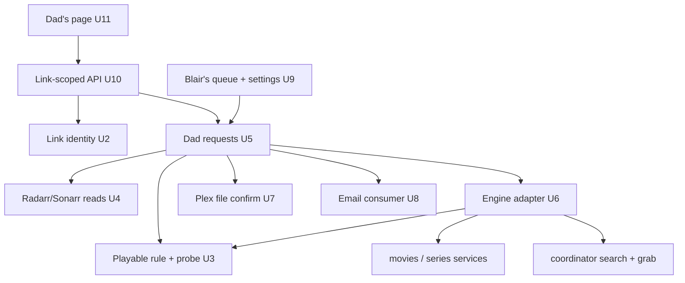
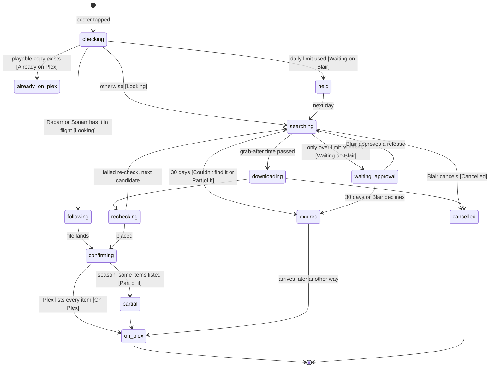

# Dad Movie Requests - Plan

## Goal Capsule

- **Objective:** Blair's dad (about 80) can get an old movie or a TV season onto Blair's Plex by typing its name into one simple page, watch it on his Apple TV, and learn by email whether it arrived, without calling Blair.
- **Means:** A separate requester path in Rock Media Center with its own request records, driving the fork's movie and TV engines through a Dad-only version track (KTD1, KTD3).
- **Product authority:** Blair. The lossless music engine, the later movie/TV takeover from Radarr and Sonarr, and the fork cleanup are separate work and not active scope here.
- **Phase:** Phase 2. Implementation starts after the lossless music engine runs on Beast. Until Blair chooses the public address for Dad's link (U13), the hub stays reachable only from the LAN and Tailscale, and Blair tests the page himself.
- **Execution profile:** Opus orchestrates Sonnet workers at medium effort, each owning the files its unit lists. Astra reviews all code before install. One adversarial review pass and one revision pass by default.
- **Who finishes:** Local commits by the orchestrating session; pushing to the fork is Blair's call. Installing on Beast is part of done; exposing the link publicly waits for Blair's address choice.
- **Stop conditions:** Stop and ask Blair if any step would change Radarr's or Sonarr's configuration or files, if the R25 playback test fails, or if Dad's link would be reachable from the internet before Blair has chosen the address.
- **Open blockers:** None for implementation. Before Dad uses the page: the public address for the link, Dad's email address, and the sending email account (Blair, at U13).

---

## Product Contract

### Summary

A separate, one-box page in Rock Media Center that Blair's dad opens from a personal link. He types a movie or show, taps the right poster (and a season, for a show), and it downloads within a quality and size limit Blair sets for him, as a file his Apple TV plays without conversion. He gets an email when it is on Plex, or when it could not be found.

Dad's requests are their own records, separate from the household request list, so his cancel, limits and 30-day give-up never touch anyone else's request. His copy of a movie is a separate version beside any file Radarr owns, which is never touched.

### Problem Frame

Blair's dad frequently asks Blair for old movies. Each request costs Blair a manual search and download. His dad already opens Blair's Plex on his Apple TV, so the only missing piece is a way to ask that he can use alone. He is nearly 80, so anything with menus, accounts or settings will not get used.

Arrmada already has an Overseerr-style request system, but it is built for logged-in household users. It has no email to requesters (only in-app inbox, Web Push and per-user Apprise URLs, `internal/requests/usernotify.go`), no sign-in by link (only local password, Plex, Jellyfin, API key), and no "not found" wording for movies (books only, `internal/requests/progress.go`).

Past incidents shape the safeguards: an ambiguous title once led to the wrong film being grabbed ("War Machine" vs *The Ministry of Ungentlemanly Warfare*); Beast has no hardware video transcoder, so a file the TV cannot play directly stutters; and Radarr and Sonarr will keep running beside this page until the later takeover.

### Actors

- A1. Dad: types a title, picks a poster, reads his email, watches on his Apple TV.
- A2. Blair: sets Dad's limits, gets a heads-up per request, can cancel, approves exceptions, can reset Dad's link.
- A3. The movie engine: matches the title, searches, downloads, verifies, places, refreshes Plex, sends email.
- A4. Plex: where the movie or season appears.
- A5. Radarr and Sonarr: still running during coexistence; may already own a title.

### Key Decisions

- **Requests start without Blair's approval; Blair can cancel.** Governs R9, R10. (session-settled: user-directed — chosen over approving each request and over a monthly cap.)
- **Dad hears back by email.** Governs R22, R23. (session-settled: user-directed — chosen over text message, page-only status, and text plus page.)
- **A personal link that works anywhere, no password.** Governs R5, R6, R7. (session-settled: user-directed — chosen over home-network-only access and Plex sign-in.) The public address is chosen in phase 2; until then the hub stays on Tailscale. (session-settled: user-directed — Blair, 2026-10-14.)
- **Blair sets the highest quality each person can get, and may approve a single request above it.** A 1972 movie must never arrive as an 80 GB file when a 1.2 GB one exists. Governs R11, R14. (session-settled: user-directed — Blair's request; one-off approval chosen over an absolute cap.)
- **Video is never re-encoded; the Convert feature is removed from the fork.** Governs R12, R14. (session-settled: user-directed — "I don't want any video conversion.")
- **Movies and single TV seasons; an airing season means the episodes aired when Dad asked.** Governs R2, R19, R20. (session-settled: user-directed — chosen over movies only, whole series, waiting for the full season, and completed seasons only.)
- **Dad watches on an Apple TV; "plays directly" is judged against Plex on Apple TV.** Governs R12, R25. (session-settled: user-directed.)
- **Low disk space pauses Blair's music upgrades and new music before Dad's requests.** Governs R18. (session-settled: user-directed.)
- **The page runs on the fork's own movie engine, not Radarr.** (session-settled: user-directed — part of choosing the fork as the whole stack.)
- **The app reads Radarr and Sonarr but never changes them; when either cannot be reached, Dad's request waits.** Governs R8. (session-settled: user-approved — chosen over fetching anyway when Radarr is unreachable.)
- **Dad's playable copy is a second version beside an unplayable one already on Plex.** Governs R3, R8. (session-settled: user-approved — chosen over skipping titles another engine owns.)
- **The first download waits 10 minutes so Blair's cancel can stop it.** Governs R9, R10. (session-settled: user-approved — chosen over grabbing at once, which leaves cancel no time to act.)
- **A request gives up after 30 days; a later arrival sends one "on Plex after all" email.** Governs R17. (session-settled: user-approved.)
- **Emails are queued once and retried for up to 3 days, then shown to Blair as failed.** Governs R23. (session-settled: user-approved — chosen over unbounded retries; "sent" means the mail server accepted it.)
- **Search shows 3 posters plus a "none of these" button that sends Blair what he typed.** Governs R2. (session-settled: user-approved.)

### Requirements

**The page**

- R1. The page shows one search box and his request list, in large type that reads comfortably on a tablet or phone.
- R2. A search shows at most 3 matching movies or shows as posters with title and year, plus a "none of these" button that sends Blair what he typed; a year typed with the title narrows the results; Dad taps one poster (and a season, for a show), so a request is never placed on an ambiguous title.
- R3. If a copy his Apple TV can play directly (R12) is already on Plex, the page says "Already on Plex" and nothing downloads; a copy that is on Plex but not directly playable is treated as missing, and his playable copy is added beside it as a second version.
- R4. Each request shows one truthful status, from this table:

| Status Dad sees | When | Email |
|---|---|---|
| Looking | searching, or downloading | none |
| Waiting on Blair | only releases above his limit exist, or his daily limit is used up | none |
| On Plex | everything requested is on Plex and plays directly | "on Plex now" |
| Part of it is on Plex (N of M) | a season where some episodes are on Plex | only at the end (R21) |
| Couldn't find it | 30 days passed with nothing usable, or Blair declined | "couldn't find it" |
| Cancelled | Blair cancelled it | "Blair cancelled this one" |

**Access**

- R5. Dad's personal link is an unguessable credential that allows only searching, placing his own requests, and reading his own requests' status; every other part of the hub refuses it.
- R6. Blair can reset the link at any time; a reset immediately ends every session opened from the old link.
- R7. The link is never written to logs; searches are rate-limited; at most 5 new requests a day start, and a further request shows "Waiting on Blair" and starts by itself the next day.

**Getting the movie**

- R8. While Radarr or Sonarr still run, a title or season one of them is already downloading or managing is not fetched again; the page follows that existing work, and the engine never replaces files another engine owns.
- R9. A request starts searching immediately, without Blair's approval; its first download waits 10 minutes after the request.
- R10. Blair gets a heads-up for each request and can cancel it with one tap; a cancel inside the 10 minutes stops it before anything downloads, and a later cancel removes whatever was fetched for this request.
- R11. Blair sets each requester's limit as a highest resolution plus a size cap that scales with runtime (per episode for TV); when a title's runtime is unknown, a flat cap per movie and per episode applies instead; without Blair's approval, Dad never receives a file above it.
- R12. A file counts as playable only if Plex on Dad's Apple TV plays it directly, video, audio and container included, with English audio present.
- R13. Among candidates within his limit that meet a minimum quality floor (a recognised release of the full title at no less than the floor resolution Blair sets), the engine picks the smallest playable one.
- R14. No video is ever re-encoded; when the only versions are over his limit, Blair may approve one specific release for this request only, and a version that is not playable is never offered for approval.
- R15. Release size, runtime, streams and identity are re-checked after download; a file that turns out over the limit, unplayable, incomplete, or a different movie is not placed, and the next candidate is tried.
- R16. The movie lands in Blair's Plex Movies library and a season in the TV library; a request becomes "On Plex" only after Plex has indexed every requested item.
- R17. A request not fulfilled keeps being searched on a growing interval for 30 days, including while it waits on Blair; at 30 days the search stops, and if the title later reaches Plex another way, Dad gets one "on Plex after all" email.
- R18. Dad's downloads count against the shared space budget; when space is short, his requests pause last, and nothing is deleted to make room.

**TV seasons**

- R19. Tapping a show lists its seasons; Dad requests one season at a time.
- R20. The episodes in a season request are fixed when Dad asks: the episodes aired by then, in the show's normal order, without specials; later episodes need a new request.
- R21. A season becomes "On Plex" when all its fixed episodes are indexed; if the 30 days end with only some, the status stays "Part of it is on Plex (N of M)" and Dad gets one email saying which are there.

**Telling Dad**

- R22. Dad gets a short plain-language email when a request is on Plex ("'Sabrina' (1954) is on Plex now. Look in Movies."), when it could not be found, and when Blair cancels it.
- R23. Emails need no clicks and never carry the link; each one is queued once, retried for up to 3 days when sending fails, and then shown to Blair as failed; an email counts as sent when the mail server accepts it.

**Blair's view**

- R24. Dad's requests appear in Blair's own queue with their state, last reason, and any approval or "none of these" note waiting on him.
- R25. Before the page goes live for Dad, Blair confirms that a movie fetched this way plays on Dad's Apple TV over his remote Plex connection without conversion, including a title that also has an unplayable version.

### Key Flows

- F1. Request to Plex
  - **Trigger:** Dad types a title and taps a poster (and a season, for a show).
  - **Actors:** A1, A2, A3, A4, A5
  - **Steps:** The page checks Plex for a playable copy and whether Radarr or Sonarr already own the title; if neither, the request starts and Blair gets a heads-up; the engine searches within Dad's limit, waits out the 10-minute hold, downloads, re-checks the file, places it, waits for Plex to index it, emails Dad.
  - **Outcome:** Dad finds it in Plex on his Apple TV.
  - **Covered by:** R2, R3, R8, R9, R10, R11, R12, R13, R15, R16, R22
- F2. Only over-limit releases
  - **Trigger:** The only playable releases found are above Dad's limit.
  - **Steps:** Dad sees "Waiting on Blair"; Blair approves one release for this request or declines; approval proceeds, decline ends as "Couldn't find it" with an email.
  - **Covered by:** R4, R14, R22

### Acceptance Examples

- AE1. **Covers R11, R13.** Given Dad's limit is 1080p and about 2 GB per hour, when he requests a 2-hour 1972 film with an 80 GB remux and a 1.2 GB 1080p release available, the 1.2 GB release is chosen.
- AE2. **Covers R13.** Given a 300 MB release below the quality floor and a 1.2 GB release within the limit both exist, the 1.2 GB release is chosen.
- AE3. **Covers R2.** Given Dad types "Sabrina", when results show the 1954 and 1995 films, nothing is requested until he taps one.
- AE4. **Covers R3.** Given Plex has only a remux his Apple TV cannot play directly, the request proceeds as if the movie were missing, and the remux is left in place.
- AE5. **Covers R14.** Given only an 80 GB remux exists, Dad sees "Waiting on Blair"; Blair's approval allows that release for this request only.
- AE6. **Covers R5, R6.** Given Blair resets the link, the old link and any session opened from it can no longer search or request; the link never opens admin pages or other users' data.
- AE7. **Covers R8.** Given Radarr is already downloading the movie, the page shows "Looking" and follows Radarr's download; no second copy is fetched.
- AE8. **Covers R15.** Given a release advertised as 1.5 GB turns out to be 9 GB, it is not placed and the next candidate is tried.
- AE9. **Covers R20, R21.** Given Dad requests season 2 while 6 of 10 episodes have aired, the request is those 6; when all 6 are on Plex he gets the "on Plex" email, and episode 7 is not fetched.
- AE10. **Covers R17, R21.** Given only 4 of the 6 are found within 30 days, his list shows "Part of it is on Plex (4 of 6)" and he gets one email saying which.
- AE11. **Covers R23.** Given the email server is down when a movie lands, the email is retried, sent once when the server returns, and Blair sees the delay; if 3 days pass, Blair sees it failed.
- AE12. **Covers R10.** Given Blair cancels 5 minutes after the request, nothing has downloaded; given he cancels while the download runs, the download and its partial files are removed and Dad gets the "cancelled" email.
- AE13. **Covers R17.** Given a request ended as "Couldn't find it" and Radarr later brings the movie in, Dad gets one "on Plex after all" email.
- AE14. **Covers R11.** Given TMDB has no runtime for a film, a 6 GB release is refused under the flat 4 GB movie cap.
- AE15. **Covers R7.** Given Dad places a 6th request in one day, it shows "Waiting on Blair" and starts the next day without Blair doing anything.

### Success Criteria

Measured over Dad's first 30 days of requests:

- Dad places requests with no help from Blair.
- At least 90% of requests with a release inside his limit reach "On Plex" within 24 hours of the request, and each of those plays on his Apple TV without conversion.
- Every request ends in a status from R4 with a delivered email where R4 calls for one; none is stuck without a reason.

### Scope Boundaries

**Deferred for later**

- Other family members (the per-person limit and link are built so more people can be added later).
- Whole-series requests and following new episodes as they air.
- Text-message notifications.
- Requesting from inside Plex itself.

**Outside this product's identity**

- Any video re-encoding or transcoding.
- Accounts, passwords or settings on Dad's side.

#### Deferred to Follow-Up Work

- Fixing Radarr's broken qBittorrent connection (its container sits only on `bridge`); that is a Beast change outside this repo, Blair's call.
- Asynchronous bounce handling (mailbox full, address gone): the hub sees only what the mail server says at send time.

**Considered and not built**

- A periodic full rescan of Blair's Movies and TV folders to adopt Radarr-delivered files: the Radarr and Sonarr reads (KTD2) already tell the app when they deliver, which is the case that matters for Dad. Revisit if a request "following Radarr" stalls.
- Showing Blair each device that opened Dad's link: the per-request heads-up already reveals a forwarded link. Revisit if a leak happens.

<!-- ce-section: work-relationships -->
### How This Work Fits Together

This plan covers Dad's request page. The broader breakdown below is the current understanding, not a committed roadmap.

- Fork cleanup (remove Books, Audiobooks, Subtitles and Convert; rebrand; repoint upstream URLs): in progress. This plan depends on it.
- Lossless music engine (`docs/plans/2026-10-14-2001-feat-lossless-music-engine-plan.md`): phase 1, built first; this plan reuses its Beast deployment (its U16), its alert delivery, and its space gate.
- Movie and TV takeover from Radarr and Sonarr: enabled by this plan, which puts the fork's movie engine into real use first; still to decide when.

### Dependencies / Assumptions

- An outgoing email account for the hub (the fork keeps Arrmada's SMTP settings) and Dad's email address, supplied by Blair at U13. Until then, notices queue and Blair's view shows "no email address set".
- Dad already has access to Blair's Plex server and watches on an Apple TV, reached remotely through the existing CGNAT tunnel.
- The fork's movie engine needs its own indexers and download clients configured beside Radarr and Sonarr, and adopts Blair's existing Movies and TV folders from disk (Arrmada cannot import from Radarr or Sonarr).
- Verified 2026-10-14 on Beast: Radarr (`:7878`) and Sonarr (`:8989`) answer on the host; Radarr's qBittorrent connection is broken and it fetches through SABnzbd only; `/mnt/nas/movies` holds 505 loose video files at its root plus 153 folders.

### Outstanding Questions

**Resolved in planning**

- Dad's default limits: KTD5.
- The direct-play rule for Plex on Apple TV: KTD6, confirmed by the R25 test.
- How the engine learns what Radarr and Sonarr own: KTD2.
- Reuse the request system or a separate requester type: separate records (KTD1).

**Deferred to Blair at U13**

- The public address for Dad's link, Dad's email address, and the sending account.

**Deferred to implementation**

- Which version the Apple TV picks when a title has two versions; the R25 test answers it and, if needed, U13 sets the playable version as the one Plex prefers.
- TMDB versus Plex episode numbering for classic shows; checked on two of Dad's likely shows during U13.

### Sources / Research

- `internal/requests/usernotify.go`, `internal/requests/notifyprefs.go`: requester notification channels today (no email).
- `internal/requests/progress.go`: "Not found yet" wording exists for books only.
- `internal/auth/autoapprove.go:55-78`: per-user, per-type auto-approve exists.
- `internal/httpapi/calendar_ics.go:23-33`, `internal/auth/calendarfeed.go`: the only existing token-URL access (calendar feed), the pattern for a scoped link.
- `internal/movies/service.go:357`, `internal/series/service.go:1620`: adopting existing folders from disk.
- Plex direct play vs direct stream (support.plex.tv article 200250387).
- Adversarial review (Astra / GPT-6, 2026-10-14): findings addressed in the requirements revision.

---

## Planning Contract

**Product Contract preservation:** changed: R2, R3, R7, R9, R10, R11, R17, R23 and R25 amended and AE12–AE15 added, from the plan-time defaults Blair approved on 2026-10-14; phase 2 placement and Tailscale-only access added from Blair's same-day instruction.

### Key Technical Decisions

- KTD1. **Dad's requests are their own records in a new `internal/askreq` package, not rows in `requests`.** The `requests` table allows one row per movie (`internal/store/migrations/0164_request_seasons.sql:9`), so a second asker becomes a follower and a cancel or decline would hit everyone on the row. The package calls the shared services (discovery, movies, series, coordinator search, mail, Plex) through small interfaces.
- KTD2. **A read-only Radarr and Sonarr client (`internal/arrclient`) decides R8.** It reads the movie and series libraries and the download queues through their v3 APIs. A title they own with a playable file ends as "Already on Plex"; a title in their queue is followed until it lands; a title whose file is unplayable gets Dad's own version (KTD3). When either service cannot be reached, the request waits as "Looking" and retries.
- KTD3. **Dad's copy is a version track with Dad's profile on an unmonitored movie row.** `movies.AddVersion` gives a track its own profile and file (`internal/movies/service.go:1294`). The search sweep picks up monitored, file-less tracks even on an unmonitored movie, and the upgrade sweep only touches monitored rows with files (`internal/movies/repo.go:213-221`), so Radarr's file is never searched for or upgraded. Dad's track carries `UpgradeHold`, so it is never replaced either.
- KTD4. **Seasons store their frozen episode list, and that list, not the monitored flag, decides what is fetched for Dad.** The list is the season's episodes with an air date on or before the request day, numbered above 0, from TMDB. Monitoring an episode also monitors its season (`internal/series/repo.go:1124`), and a metadata refresh then monitors newly found episodes of that season (`internal/series/service.go:463`), so the flag cannot hold the boundary. The acquisition gate (KTD13) refuses any grab for a Dad-only series episode outside the list, the TV import gate (KTD14) refuses any such file, and a post-refresh step unmonitors episodes outside the list on series that are monitored only because of Dad. Completion is judged against the stored list, never the live season (AE9).
- KTD13. **One acquisition gate guards every grab for a title Dad's request touches.** Search, RSS and failover all reach `Grab` through shared code in `internal/automation/coordinator.go` (around lines 1180 and 1263), and `SearchMovieManual` grabs immediately (line 952). A single check at the grab boundary refuses a grab for a Dad track or Dad episode unless the request is active, its grab-after time has passed, it is not expired or cancelled, Radarr and Sonarr still do not own the item, and Dad's space floor allows it. Search results are still recorded, so "Waiting on Blair" can be detected.
- KTD14. **Dad's TV files have their own records and placement, and never supersede another engine's file.** The ordinary TV import calls `SupersedeEpisodeFile` (`internal/automation/reviews.go:1016`), which can recycle the existing file (`internal/series/service.go:1801`). For an episode in a Dad request, the import goes through a Dad path instead: the file is checked (size, playability, identity, membership in the frozen list), placed in the season folder under a distinct name carrying the same `SxxEyy` so Plex shows it as a second version, and recorded in `ask_episode_files`. The ordinary supersede and delete paths skip files recorded there and files Sonarr owns.
- KTD5. **Dad's limit is a named quality profile plus a per-requester limits row.** Defaults: 1080p highest, 720p floor, 2 GiB per hour (about 4.77 Mbps on the existing bitrate ceiling), a flat 4 GB per movie and 1.5 GB per episode when runtime is unknown, 5 requests per day. Ranking uses a single-resolution-first pass with a high size bias so the smallest playable candidate wins (R13); a unit test pins AE1 and AE2. The flat cap closes the gap where the existing cap is skipped when runtime is unknown (`internal/quality/quality.go:597-610`).
- KTD6. **One function decides "playable on Dad's Apple TV".** It lives in `internal/playable` and is used before download (release-name steering), for R3, and after download (R15). Its starting rule, to be confirmed by R25: video H.264, or HEVC without Dolby Vision profile 5; audio AAC, AC3 or E-AC3 with an English track; container MP4, MKV or MOV; no forced image-based subtitles. The rule is data, so R25's findings change it without code changes. It reads streams from an extended `internal/mediainfo` probe (all audio streams with language, container, video profile, subtitle types).
- KTD7. **"On Plex" is confirmed per file, never by the 30-minute grace in `internal/requests/plexready.go`.** A movie is on Plex when Plex lists a media part at Dad's file path; an episode, when Plex lists that episode with a media part. The request waits as "Looking" until then.
- KTD8. **The link token travels in the URL fragment and is exchanged once for a link session.** A fragment never reaches the server, Cloudflare or the logs. Link sessions live in their own table and are resolved under their own request-context key, so every existing route sees no user and answers 401 (R5). A new router scope, `link`, holds Dad's routes and appears in `routes.golden`. The link stays the durable entry: opening it again mints a new session, so a bookmark keeps working until a reset. Reset rotates the token and deletes the link sessions in one transaction (R6).
- KTD9. **Email goes through a new outbox consumer with a sent-marker and a 3-day retry lifetime.** `mailConfig` moves out of `internal/httpapi/smtp.go` into `internal/mail` so a background sender can use it. A unique row per request and email kind is written after a successful send and checked first, so a retried job does not resend (R23). The outbox gives up after 20 attempts today (`internal/outbox/outbox.go:51`), well short of 3 days, so it gains a per-consumer option that bounds retries by elapsed time instead of attempt count; the email consumer uses 3 days, then the email shows as failed in Blair's view.
- KTD10. **Dad's downloads check a lower space floor than music.** Music pauses at 100 GB free (music plan KTD10); Dad's grabs pause at 25 GB free, so music always pauses first (R18).
- KTD11. **Dad's movie grabs pass a Dad-specific import check composed with the existing `HoldMovieImport` gate.** It re-checks size against the limit (or the approved release), runtime, playability (KTD6) and identity (R15). A failure blocklists the release and searches again (`BlocklistAndSearch`). TV files go through the Dad path in KTD14, which applies the same checks per episode, including packs and multi-episode files.
- KTD12. **The 10-minute hold is a per-request "grab after" time, enforced by the acquisition gate (KTD13).** Search runs at once so the status is truthful, but no grab is sent before the time passes (R9, R10). Retries follow a per-request next-search time that doubles from 30 minutes to a 12-hour cap and survives restarts, including while waiting on Blair (R17).

### High-Level Technical Design

Request lifecycle, with the status Dad sees in brackets:

### Sequencing

File ownership is phase-qualified: U12 and U13 reuse files that the music plan's U15 and U16 owned, and start only after phase 1 is committed. U1 first. U2, U3, U4, U7 and U8 then run in parallel. U5 follows U1, U3, U4 and U7. U6 follows U3 and U5. U9 and U10 follow U5. U11 follows U10. U12 wires everything. U13 installs and runs the release checks.

---

## Implementation Units

| U-ID | Title | Key files | Depends on |
|---|---|---|---|
| U1 | Schema | `internal/store/migrations/0420_askreq.sql` | music phase 1 |
| U2 | Link identity | `internal/auth/asklink.go`, `internal/httpapi/router.go`, `internal/httpapi/auth.go` | U1 |
| U3 | Probe and playable rule | `internal/mediainfo/`, `internal/playable/` | music phase 1 |
| U4 | Radarr and Sonarr reads | `internal/arrclient/` | music phase 1 |
| U5 | Dad request domain | `internal/askreq/` | U1, U3, U4, U7 |
| U6 | Engine adapter and gates | `internal/askreq/engine.go`, `internal/automation/askgate.go`, `asktv.go`, `coordinator.go` | U3, U5 |
| U7 | Plex file confirm | `internal/plex/files.go` | music phase 1 |
| U8 | Email | `internal/mail/config.go`, `internal/outbox/outbox.go`, `internal/askreq/email.go` | U1 |
| U9 | Blair's controls | `internal/httpapi/askadmin.go`, `internal/notify/catalog_ask.go`, web admin pages | U5 |
| U10 | Dad's API | `internal/httpapi/ask.go` | U2, U5 |
| U11 | Dad's page | `web/src/ask/` | U10 |
| U12 | Wiring | `cmd/arrmada/main.go`, `cmd/arrmada/outbox.go`, `internal/httpapi/server.go`, shared lists | U1–U11 |
| U13 | Install, R25 test, go live | `deploy/beast/` | U12 |

### U1. Schema

- **Goal:** Create the tables for links, link sessions, limits, Dad's requests, frozen episodes, approvals and sent emails.
- **Requirements:** R4–R7, R11, R14, R17, R20, R23, R24; KTD1, KTD4, KTD5, KTD8, KTD9, KTD12.
- **Dependencies:** Music phase 1 merged (migration numbers 0400–0419 belong to it).
- **Files:** `internal/store/migrations/0420_askreq.sql`, `internal/store/askreq_migration_test.go`.
- **Approach:**
  1. `ask_links` (user, token hash, created at), modelled on `calendar_feeds`; `ask_sessions` (token hash, user, created, last seen).
  2. `requester_limits` (user, profile, flat movie and episode caps, daily count, notify email).
  3. `ask_requests` (user, media type, TMDB id, season, state, Dad status, last reason, created at, grab after, next search at, retry interval, expires at, approved release, movie version id, series id, cancelled at); `ask_request_episodes` (request, season, episode, on Plex at); `ask_episode_files` (request, episode, path, size, placed at); `ask_notes` for "none of these".
  4. `ask_emails` (request, kind) unique, with sent at, message id, failed at.
  5. Numbers 0421–0439 stay reserved for later units of this plan.
- **Patterns to follow:** `internal/store/migrations/0299_calendar_feeds.sql`; `internal/store/grab_transport_migration_test.go`.
- **Test scenarios:**
  - Migrating through 0420 creates every table, and the migration lint passes.
  - A second `ask_emails` row for the same request and kind fails.
  - Two requests by Dad for the same movie are allowed only when the first has ended.
- **Verification:** `go test ./internal/store/...` passes.

### U2. Link identity

- **Goal:** A link that opens a session able to reach only Dad's routes.
- **Requirements:** R5, R6, R7; AE6; KTD8.
- **Dependencies:** U1.
- **Files:** `internal/auth/asklink.go`, `internal/auth/asklink_test.go`, `internal/httpapi/router.go`, `internal/httpapi/auth.go`, `internal/httpapi/asklink.go`, `internal/httpapi/asklink_test.go`, `internal/httpapi/routes_test.go`.
- **Approach:**
  1. Issue, rotate and resolve link tokens (32 random bytes, hash stored); exchange a token for a link session; reset deletes the user's link sessions in the same transaction.
  2. `authenticate` resolves a link-session cookie into its own context key and never into the normal user key.
  3. A `link` router scope accepts only link sessions and is marked reachable from outside.
  4. The exchange endpoint is rate-limited per IP with the existing login limiter; its pages send `Referrer-Policy: no-referrer`.
- **Patterns to follow:** `internal/auth/calendarfeed.go`; `scoped()` in `internal/httpapi/router.go`.
- **Test scenarios:**
  - A valid token exchanges for a session that can call a `link` route.
  - A link session calling every protected non-link route in the route table gets 401, and public routes behave exactly as they do for an anonymous caller; `routes_test.go`'s authorization matrix includes link sessions. Covers AE6.
  - Through the full middleware chain, a link cookie, an ordinary cookie, a reset link and a disabled user each get the expected answer.
  - After reset, the old token and the old session both fail. Covers AE6.
  - An unknown token and a disabled user return the same error.
  - The exchange endpoint rate-limits after repeated bad tokens.
  - A normal user session gets 401 on `link` routes.
- **Verification:** `go test ./internal/auth/... ./internal/httpapi/...` passes, including the route authorization tests.

### U3. Probe and playable rule

- **Goal:** Read every stream a file has, and decide playability with one rule.
- **Requirements:** R3, R12, R14, R15; KTD6.
- **Dependencies:** Music phase 1 merged.
- **Files:** `internal/mediainfo/mediainfo.go`, `internal/mediainfo/mediainfo_test.go`, `internal/playable/playable.go`, `internal/playable/rule.go`, `internal/playable/playable_test.go`.
- **Approach:** Extend the probe to return container, video codec, profile and Dolby Vision profile, every audio stream with codec and language, and subtitle streams with codec and forced flag, keeping existing fields unchanged. `playable` takes a probe result (after download) or a parsed release name (before download) and returns playable, unplayable with reason, or unknown. Before download, "unknown" is allowed and R15 decides; "unplayable" is filtered out.
- **Patterns to follow:** existing `internal/mediainfo` ffprobe through `toolrun`; `internal/parser` release fields.
- **Test scenarios:**
  - H.264, AAC English, MKV is playable.
  - HEVC with Dolby Vision profile 5 only is unplayable with that reason.
  - A file whose only English audio is DTS is unplayable.
  - A file with no English audio track is unplayable.
  - A release name saying "x265 TrueHD" is unplayable before download; one with no codec words is unknown.
  - Existing mediainfo callers get the same values for the fields they read today.
- **Verification:** `go test ./internal/mediainfo/... ./internal/playable/...` passes.

### U4. Radarr and Sonarr reads

- **Goal:** Know what Radarr and Sonarr own and are downloading, without changing them.
- **Requirements:** R8; AE7, AE13; KTD2.
- **Dependencies:** Music phase 1 merged.
- **Files:** `internal/arrclient/client.go`, `internal/arrclient/radarr.go`, `internal/arrclient/sonarr.go`, `internal/arrclient/client_test.go`.
- **Approach:** GET-only calls: Radarr movie by TMDB id with file path, Radarr queue; Sonarr series by TVDB or TMDB id, episode files for a season, Sonarr queue. API keys come from the key store. Any error is returned as unreachable, never as "not found".
- **Patterns to follow:** `internal/plex/client_test.go` httptest fakes.
- **Test scenarios:**
  - A movie Radarr has with a file returns its path.
  - A movie in Radarr's queue is reported in flight.
  - Sonarr reports which episodes of a season have files.
  - A connection refused returns unreachable, not "not owned".
  - No method sends anything but GET.
- **Verification:** `go test ./internal/arrclient/...` passes.

### U5. Dad request domain

- **Goal:** Create, track, cancel, expire and report Dad's requests.
- **Requirements:** R2–R4, R7–R10, R16, R17, R19–R21, R24; AE3, AE4, AE7, AE9, AE10, AE12, AE13, AE15; KTD1, KTD2, KTD4, KTD7, KTD12.
- **Dependencies:** U1, U3, U4, U7.
- **Files:** `internal/askreq/service.go`, `state.go`, `repo.go`, `create.go`, `cancel.go`, `expiry.go`, `seasons.go`, `status.go`, `retry.go`, `interfaces.go`, and `create_test.go`, `cancel_test.go`, `expiry_test.go`, `seasons_test.go`, `status_test.go`, `retry_test.go`.
- **Approach:**
  1. Create runs the checks in F1: playable copy on Plex (U3, U7), Radarr or Sonarr ownership (U4), daily limit; then stores the request with its grab-after time and, for a season, its frozen episode list (KTD4).
  2. Status maps internal state to the six Dad statuses in R4 in one function.
  3. Cancel acts by state: before grab-after, it stops the search; during download, it removes the client job and partial files; after placement, it removes only what was fetched for this request; it never touches Radarr or Sonarr work.
  4. A daily task expires requests at 30 days, unmonitors what was monitored only for them, and releases held requests the next day (R7). A later arrival through Radarr or Sonarr sends one "after all" email (AE13).
  5. A completion task checks Plex per file or episode (KTD7) and moves requests to "On Plex" or "Part of it".
  6. A retry dispatcher triggers a search for each active request whose next-search time has passed, including requests waiting on Blair, and doubles the interval after a miss (KTD12). An in-limit release found while waiting on Blair withdraws the approval and proceeds.
- **Patterns to follow:** `internal/requests/seasonplan.go`, `internal/requests/progress.go` stage vocabulary.
- **Test scenarios:**
  - Tapping "Sabrina (1954)" creates one request for that TMDB id only. Covers AE3.
  - A remux already on Plex that is unplayable leads to a new request, not "Already on Plex". Covers AE4.
  - A title in Radarr's queue becomes a followed request and nothing is grabbed. Covers AE7.
  - Season 2 with 6 of 10 aired freezes 6 episodes; episode 7 airing later is not monitored. Covers AE9.
  - At 30 days with 4 of 6 on Plex, the status is "Part of it is on Plex (4 of 6)" and one email is queued. Covers AE10.
  - Cancel 5 minutes in sends no grab; cancel during download removes the job and files and queues the "cancelled" email. Covers AE12.
  - A request expired as "Couldn't find it" whose movie Radarr later delivers queues one "after all" email. Covers AE13.
  - The 6th request in a day is held and starts the next day. Covers AE15.
  - Radarr unreachable leaves the request "Looking" and retries.
  - Missed searches space out at 30 minutes, 1 hour, 2 hours, and keep that schedule across a restart.
  - A request waiting on Blair whose next search finds an in-limit release proceeds and drops the approval ask.
  - At expiry, no further search is triggered for the request.
- **Verification:** `go test ./internal/askreq/...` passes.

### U6. Engine adapter

- **Goal:** Fetch Dad's copy within his limit, never touching another engine's file.
- **Requirements:** R8, R11, R13–R15, R18, R20; AE1, AE2, AE5, AE8, AE9, AE14; KTD3, KTD4, KTD5, KTD10, KTD11, KTD12, KTD13, KTD14.
- **Dependencies:** U3, U5.
- **Files:** `internal/askreq/engine.go`, `internal/askreq/engine_test.go`, `internal/automation/askgate.go`, `internal/automation/asktv.go`, `internal/automation/coordinator.go`, `internal/automation/reviews.go`, `internal/automation/series.go`, `internal/series/service.go`, `internal/quality/askprofile.go`, and `internal/automation/askgate_test.go`, `internal/automation/asktv_test.go`, `internal/quality/askprofile_test.go`.
- **Approach:**
  1. For a movie: adopt or add the movie unmonitored, add a Dad version track with his profile and `UpgradeHold` (KTD3), and search through the path that checks for downloads already in flight.
  2. For a season: add or adopt the series and monitor only the frozen episodes; a post-refresh hook in `internal/series/service.go` unmonitors episodes outside the list on Dad-only series (KTD4).
  3. `askprofile.go` builds Dad's profile from his limits row, including the flat cap for unknown runtime and the smallest-first ranking (KTD5).
  4. The acquisition gate (KTD13) is one check called at the grab boundary in `coordinator.go`, covering search, RSS, manual search and failover.
  5. `askgate.go` is the Dad movie import check (KTD11), composed with `HoldMovieImport` by U12; an approved release is exempt from the size limit only.
  6. `asktv.go` is the Dad TV import path (KTD14), entered from the existing TV import in `series.go` and `reviews.go` for episodes in a Dad request; the ordinary supersede and delete paths skip Dad-recorded and Sonarr-owned files.
- **Patterns to follow:** `coordinator.SearchMovieManual`; `RankReleases`; `BlocklistAndSearch` in `internal/automation/coordinator.go`.
- **Test scenarios:**
  - With an 80 GB remux and a 1.2 GB 1080p release, the 1.2 GB release is chosen. Covers AE1.
  - With a 300 MB 480p release and a 1.2 GB 1080p release, the 1.2 GB release is chosen. Covers AE2.
  - With only an 80 GB remux, the request goes to "Waiting on Blair" with that release offered. Covers AE5.
  - A download advertised at 1.5 GB that arrives as 9 GB is refused by the import check and the next candidate is searched. Covers AE8.
  - With no runtime known, a 6 GB release is refused. Covers AE14.
  - An approved over-limit release passes the import check; a different over-limit release does not.
  - The upgrade sweep never selects Dad's track or Radarr's file.
  - Below Dad's space floor no grab is sent; between Dad's and music's floors Dad's grab proceeds.
  - Driving the real coordinator's RSS and search paths: no grab for a Dad item before grab-after, after cancel, after expiry, or once Radarr owns it.
  - After a metadata refresh adds episode 7 and its air date passes, a sweep and an RSS hit for it are refused, and a season pack containing it places only episodes 1–6. Covers AE9.
  - An oversized, an unplayable, and an unrequested episode in a pack are not placed.
  - With an unplayable Sonarr-owned episode present, Dad's copy is placed under a second name and the Sonarr file's path and checksum are unchanged; cancelling removes only Dad's copy.
- **Verification:** `go test ./internal/askreq/... ./internal/automation/... ./internal/quality/...` passes.

### U7. Plex file confirm

- **Goal:** Tell whether Plex lists a given movie file or episode.
- **Requirements:** R3, R16, R21; KTD7.
- **Dependencies:** Music phase 1 merged.
- **Files:** `internal/plex/files.go`, `internal/plex/files_test.go`.
- **Approach:** Look up a movie in a section by TMDB guid and return its media parts with file paths; list a show's episodes for a season with their media parts. Reuse the client's paging and errors.
- **Patterns to follow:** `internal/plex/client.go`; music plan U5's `internal/plex/music.go`.
- **Test scenarios:**
  - A movie with two versions returns both file paths.
  - A season returns each episode with or without a media part.
  - A movie not in the section returns not found, distinct from a Plex error.
- **Verification:** `go test ./internal/plex/...` passes.

### U8. Email

- **Goal:** Send Dad's notices once, with retries, and show failures to Blair.
- **Requirements:** R22, R23; AE11; KTD9.
- **Dependencies:** U1.
- **Files:** `internal/mail/config.go`, `internal/mail/config_test.go`, `internal/httpapi/smtp.go`, `internal/outbox/outbox.go`, `internal/outbox/outbox_test.go`, `internal/askreq/email.go`, `internal/askreq/email_test.go`, `internal/askreq/templates.go`.
- **Approach:** Move the SMTP config loader into `internal/mail` and have `smtp.go` call it. Add the elapsed-time retry option to the outbox (KTD9); consumers without it keep today's attempt limit. The email consumer reads the sent-marker first, sends a plain-text email from a template, then writes the marker; retries run for 3 days, then the email is marked failed. No email body contains the link. With no address set, the email is held and Blair's view says so.
- **Patterns to follow:** `internal/outbox` consumer registration in `cmd/arrmada/outbox.go`; `internal/mail/smtp.go`.
- **Test scenarios:**
  - An "on Plex" notice sends once; a second run of the same job sends nothing. Covers AE11.
  - With the fake server down, the job retries and sends when it returns. Covers AE11.
  - With the server down for 2 days (past 20 attempts), the email still retries and sends when the server returns; after 3 days of failures it is marked failed. Covers AE11.
  - An existing outbox consumer still stops after 20 attempts.
  - No template output contains the link token or the word "click".
  - With no address set, nothing is sent and the hold reason is recorded.
  - The SMTP settings card still loads and saves the same values.
- **Verification:** `go test ./internal/mail/... ./internal/askreq/... ./internal/httpapi/...` passes.

### U9. Blair's controls

- **Goal:** Heads-ups with one-tap cancel, an approvals queue, and Dad's link and limits settings.
- **Requirements:** R6, R10, R11, R14, R24; KTD5, KTD8.
- **Dependencies:** U5.
- **Files:** `internal/httpapi/askadmin.go`, `internal/httpapi/askadmin_test.go`, `internal/notify/catalog_ask.go`, `internal/notify/catalog_ask_test.go`, `web/src/lib/askAdminApi.ts`, `web/src/pages/AskQueue.tsx`, `web/src/pages/AskQueue.test.tsx`, `web/src/pages/settings/AskLinkCard.tsx`, `web/src/pages/settings/AskLinkCard.test.tsx`.
- **Approach:** Admin routes to list Dad's requests with state and reason, cancel, approve or decline an over-limit release, read "none of these" notes, issue or reset the link, and edit limits and Dad's email. The heads-up alert links to the cancel action. The queue page and settings card call `askAdminApi.ts` only.
- **Patterns to follow:** `web/src/components/CalendarFeed.tsx`; `internal/notify/catalog_issues.go`.
- **Test scenarios:**
  - A non-admin gets 403 on every admin route.
  - Approving a specific release moves the request back to searching with that release recorded.
  - Declining ends the request as "Couldn't find it" and queues the email.
  - Resetting the link returns a new link once and never shows the old one again.
  - The queue page shows each request's status, reason and pending approval.
- **Verification:** Go and web tests pass.

### U10. Dad's API

- **Goal:** The only routes Dad's link can reach.
- **Requirements:** R1, R2, R5, R7, R19; AE3; KTD8.
- **Dependencies:** U2, U5.
- **Files:** `internal/httpapi/ask.go`, `internal/httpapi/ask_test.go`.
- **Approach:** `link`-scoped routes: search (at most 3 results plus the "none of these" action, a trailing year narrows the search, unreleased titles hidden), seasons of a show, create a request, list his requests with Dad statuses, send a "none of these" note. Search is rate-limited per link user.
- **Patterns to follow:** `internal/httpapi/discover.go` search and enrichment.
- **Test scenarios:**
  - "sabrina" returns at most 3 results; "sabrina 1954" puts the 1954 film first.
  - A show's seasons exclude season 0.
  - A season with no aired episodes cannot be requested and says so.
  - Rapid searches past the limit get a rate-limit answer.
  - The list returns only this link user's requests.
- **Verification:** `go test ./internal/httpapi/...` passes.

### U11. Dad's page

- **Goal:** One large-type page with a search box and his list.
- **Requirements:** R1, R2, R4, R19.
- **Dependencies:** U10.
- **Files:** `web/src/ask/AskPage.tsx`, `web/src/ask/SearchResults.tsx`, `web/src/ask/RequestList.tsx`, `web/src/ask/askApi.ts`, `web/src/ask/AskPage.test.tsx`, `web/src/main.tsx`.
- **Approach:** `main.tsx` renders the ask page for the `/ask` path before the normal sign-in flow. The page reads the token from the fragment, exchanges it, and removes it from the address bar. It handles its own 401 with "This link was reset — ask Blair". Search is debounced. Posters show "Already on Plex" or "Already asked" before a tap. All calls go through `askApi.ts`.
- **Patterns to follow:** UI kit in `web/src/ui/`; `web/src/components/SeasonPicker.tsx`.
- **Test scenarios:**
  - Opening `/ask#token` exchanges the token and clears the fragment.
  - A 401 shows the reset message, not the sign-in page.
  - Typing triggers one search after the debounce.
  - Tapping a show then a season sends one request for that season.
  - Each of the six statuses renders with its wording from R4.
- **Verification:** `npm test`, `npm run lint` and `npm run build` in `web/` pass at baseline.

### U12. Wiring

- **Goal:** Connect the units, touching every shared file in one unit.
- **Requirements:** R8, R23; KTD8, KTD9, KTD11.
- **Dependencies:** U1–U11.
- **Files:** `cmd/arrmada/main.go`, `cmd/arrmada/outbox.go`, `internal/httpapi/server.go`, `internal/httpapi/testdata/routes.golden`, `internal/apikeys/apikeys.go`, `web/src/lib/routes.tsx`, `web/src/lib/nav.ts`.
- **Approach:** Build the services; compose the Dad import check with `HoldMovieImport`; register the email consumer, the expiry and completion tasks; register admin and link routes and regenerate `routes.golden`; add Radarr and Sonarr API keys; add the admin queue route and nav entry.
- **Patterns to follow:** music plan U15.
- **Test scenarios:**
  - `routes.golden` lists the `link` routes with their scope and nothing else changes.
  - The composed import gate holds a Dad file that fails the Dad check and passes other movies unchanged.
- **Verification:** the full Verification Contract passes.

### U13. Install, R25 test and go live

- **Goal:** Run the page on Beast, prove playback on Dad's Apple TV, then give Dad his link.
- **Requirements:** R25; Success Criteria; Blair's U13 inputs.
- **Dependencies:** U12; music plan U16 (the running deployment).
- **Files:** `deploy/beast/README.md`.
- **Approach:**
  1. Redeploy the existing Rock Media Center container on Beast, still on the LAN and Tailscale only.
  2. Configure the fork's movie and TV roots, indexers and download clients beside Radarr and Sonarr, and adopt the existing folders after a dry run on a copy (505 loose files sit at the movies root).
  3. Blair tests from Tailscale: a movie request, a season request, a cancel, an over-limit approval.
  4. R25 test: play a fetched movie and a two-version title on Dad's Apple TV over his remote connection, and read Plex's session decisions (video and audio "copy"). Update the playable rule if needed.
  5. Only after Blair supplies the public address, Dad's email and the sending account: expose the `/ask` routes at that address, send a test email Dad confirms, and give Dad his link.
- **Execution note:** Install and observation; prove it with runtime evidence on Beast.
- **Test expectation:** none -- deployment and operational checks; the evidence is the observed outcomes below.
- **Verification:**
  - Blair's Tailscale test requests reach "On Plex" with the right email queued.
  - The R25 session shows video and audio direct play on Dad's Apple TV.
  - Radarr's and Sonarr's configuration and files are unchanged before and after.
  - Before Blair's address choice, the `/ask` routes are not reachable from the internet.

---

## Verification Contract

| Gate | Command (repo root unless noted) | Pass bar |
|---|---|---|
| Go build and vet | `go build ./...`, `go vet ./...` | exit 0 |
| Go tests | `go test ./...` | no failures beyond the baseline recorded before U1 |
| Route table | `go test ./internal/httpapi/ -run 'TestRouteScopesGolden|TestRouteAuthz'` (regenerate the golden separately and review its diff) | both pass, with link sessions in the authorization matrix |
| Web | in `web/`: `npm run build`, `npm run lint`, `npx vitest run`, `npx tsc --noEmit -p e2e` | build, lint and typecheck exit 0; vitest failures only the pre-existing `src/lib/theme.test.ts` cases |
| Code review | Astra review of the full diff | every verified finding fixed once |
| Beast | U13 verification list | every item observed |

---

## Definition of Done

- Every unit's verification passes, and the Verification Contract passes at or better than the baseline recorded before U1.
- The R25 test passed on Dad's Apple TV.
- Radarr and Sonarr configuration and files are unchanged.
- Dad's link reaches only his routes; nothing else in the hub accepts it.
- No credential appears in the repository or in any script.
- Code from abandoned approaches is removed from the diff.
- Work is committed locally; pushing to the fork waits for Blair. Giving Dad his link waits for Blair's U13 inputs.
