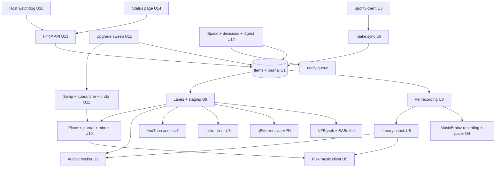
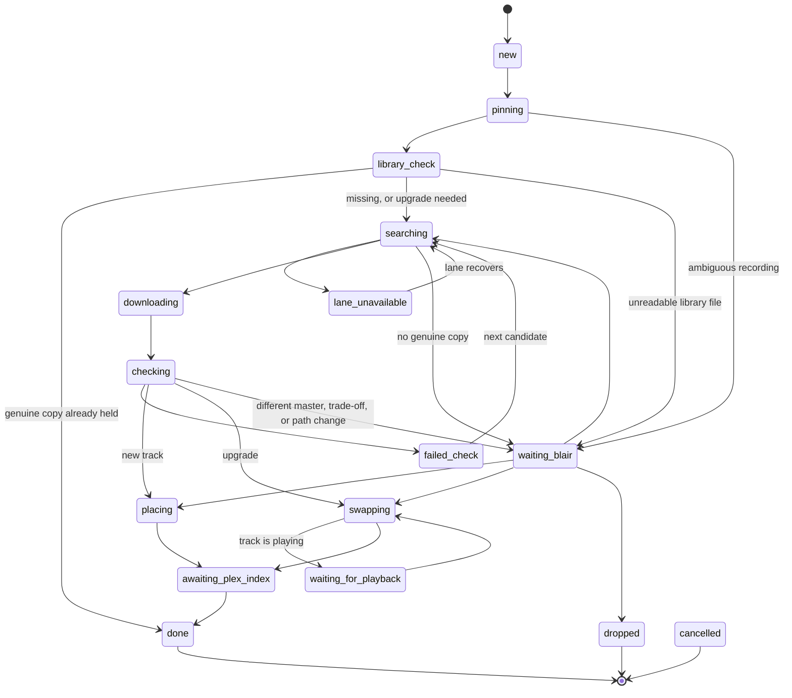

# Lossless Music Engine - Plan

## Goal Capsule

- **Objective:** Songs Blair Shazams or adds to his watched Spotify playlist, and the songs he already plays, end up in his Plex library as the best verified-genuine copy that exists, playable in Plexamp, with no manual download work, no duplicates, and no silent failures.
- **Means:** A new track-level engine inside Rock Media Center, built beside the existing album-based music module, with the `getmusic` pipeline ported into Go (KTD1, KTD5).
- **Product authority:** Blair (owner and only user of the music engine). Dad's request page, the later movie/TV takeover from Radarr and Sonarr, and the fork cleanup are separate work and not active scope here.
- **Execution profile:** Opus orchestrates Sonnet workers at medium effort, each owning the files its unit lists (KTD17). Astra reviews all code before install on Beast. One adversarial review pass and one revision pass by default.
- **Who finishes:** Local commits are made by the orchestrating session; pushing to the fork is Blair's call. Installing on Beast is authorized and is part of done (U16).
- **Stop conditions:** Stop and ask Blair if the fork cleanup has not been committed, if NZBgeek rejects the app's requests after U15, if the R13 calibration run or the Plex path test fails, or if any step would change Radarr, Sonarr, Navidrome or Rock Wave configuration.
- **Open blockers:** None.

---

## Product Contract

### Summary

Rock Media Center gains a lossless music engine that does what the `getmusic` skill does today, without a person driving it. It has two ways in: a watched Spotify playlist (starting with "My Shazam Tracks") that fetches single songs with the full album one tap away, and an upgrade sweep that replaces worse copies of the music Blair actually plays. Nothing downloads before the library is checked, every file passes an audio authenticity and integrity check before it reaches the library, and every item's state is visible on one page.

The engine is a new package beside the existing album module, which stays off. It learns the library from Plex and checks each request against it on demand, so the first run over the 90 Shazam songs places only what is missing or worse. Automatic swaps ship switched off and are enabled only after the checker and a test swap pass on Beast.

### Problem Frame

Blair finds music fine on Spotify and Shazam. The cost is the step after: getting a genuine lossless copy into his own library. Today that is a manual `getmusic` run per song (MusicBrainz lookup, NZBgeek search, SABnzbd, spectral check, tagging, placement, Plex refresh).

Every unattended attempt so far has failed quietly:

- `spotify-sync.py` on Beast turned Liked Songs into a Plex playlist and added each song's whole artist to Lidarr (97 artists from 1,707 songs). Its user login was revoked; it has failed daily since 2026-08-31, and its "Spotify Likes" playlist now returns 0 items despite reporting 497.
- Lidarr was stopped 2026-07-21 after a 537-track fake-FLAC backlog and unwanted upgrade-drip notifications.
- The library repair campaign (3,639 albums queued alphabetically) improved 0 of the 154 albums it reached and died on 2026-10-13 when the disk filled. Nothing alerted anyone.

The library is 81,733 tracks, 98.3% FLAC; of 65,740 audited FLACs, 14.9% are SUSPECT, 621 FAKE, 62 BLIND. Only 1.8% of tracks have ever been played, almost all through Plex/Plexamp. A check of the 90 songs in "My Shazam Tracks" on 2026-10-14 found about 43 already genuine in the library, 8 present but SUSPECT, and 38 missing, so blind fetching would duplicate half of them.

Arrmada's existing music module does not cover this: it is album-only (`internal/music/music.go:4`), judges quality from the release name, records bitrate 0 on import, never checks audio content, and never refreshes Plex after a music import.

### Actors

- A1. Blair: adds songs on Spotify/Shazam, answers the daily decision list, reads the daily summary, can undo a swap.
- A2. Spotify: source of the watched playlist and each song's identity.
- A3. The engine: identifies, checks the library, searches, downloads, verifies, places, refreshes Plex, reports.
- A4. Download sources: usenet (NZBgeek + SABnzbd), torrents and Soulseek (only through the VPN), YouTube official audio (only with Blair's per-song approval).
- A5. Plex / Plexamp: where Blair listens; the system of record for plays, playlists and ratings.

### Key Decisions

- **The fork becomes the whole media stack, built in stages; music comes first.** (session-settled: user-directed — chosen over keeping Radarr/Sonarr for video and over a no-fork script service: one app, one place to see failures.)
- **A watched public Spotify playlist is the order, starting with "My Shazam Tracks".** Adding a song is Blair's explicit request, which keeps the standing no-auto-download rule intact for new music. Governs R1, R2, R3, R4. (session-settled: user-directed — chosen over share links, both, and syncing Liked Songs; the Shazam playlist was chosen over a new dedicated playlist.)
- **The 90 songs already in the Shazam playlist are requests too.** Governs R2. (session-settled: user-directed — chosen over new-songs-only and over a pick list.)
- **The library is always checked first; a flagged or lossy library copy turns a request into an upgrade, never a duplicate.** Governs R7. (session-settled: user-directed — "never download something without checking to see if I have it in a higher resolution already in my library.")
- **A song request files one track; the album is a one-tap follow-up.** Governs R10, R11. (session-settled: user-directed — chosen over always-whole-album and Spotify album-vs-track inference.)
- **When no genuine lossless copy exists, Blair decides per song.** Governs R15. (session-settled: user-directed — chosen over auto-taking honest lossy and over waiting for lossless only.)
- **The upgrade sweep works on what Blair plays first.** Governs R20. (session-settled: user-directed — chosen over fakes-first across the library and over manual-only upgrades.)
- **Strictly better copies of the same master swap in automatically; nothing may get worse.** This reverses the July 2026 "no unattended replacements" rule for upgrades only. A different mastering, or a trade-off between bit depth and sample rate, goes to Blair. Governs R21, R22. (session-settled: user-directed — chosen over an approval queue, find-only reporting, allowing remasters, and bit-depth-wins.)
- **A swap that would move a library file goes to Blair.** A format change such as a YouTube `.m4a` upgraded to `.flac` changes the path and would drop the song from Navidrome's "Rock Wave Rock" playlist. Governs R22. (session-settled: user-approved — chosen over automatic path-changing swaps.)
- **Automatic swaps ship switched off until two checks pass on Beast.** Governs R13. (session-settled: user-approved — chosen over enabling swaps on the calibration run alone.)
- **An undone swap permanently blocks that exact candidate for that track.** Prevents the same swap recurring. Governs R25.
- **Low disk space pauses work in order: upgrade sweep first, then new music; nothing is ever deleted to make room.** Governs R28. (session-settled: user-directed — chosen over pausing everything at once.)
- **Quarantine is never cleared automatically; it has its own space share and a clear action only Blair triggers.** Governs R34. (session-settled: user-approved — chosen over an automatic retention window and over unbounded quarantine that would eventually pause the engine for good.)
- **Each alert is queued once and retried until delivered; a crash in the instant after a send may repeat one message.** Governs R31. (session-settled: user-approved — chosen over at-most-once delivery that can silently lose an alert.)
- **Authenticity is decided by the audio, never the release name.** The `getmusic` `flac-check.py` v3 logic is the starting standard, extended with a full-file integrity check. Governs R12, R13, R14.
- **Plex stays the listening surface; Navidrome and Rock Wave are untouched.** Governs R18.

### Requirements

**Intake**

- R1. The engine watches one public Spotify playlist that Blair designates in settings, initially "My Shazam Tracks" (id `5hLOEmkXHaXQDDbvoFFLX8`, owner `sunygxc`).
- R2. When a playlist is first watched, every song already in it becomes a request; afterwards, each song newly added becomes a request.
- R3. Each playlist entry produces at most one request, identified by the song itself, so re-reads, reconnects and duplicates in the playlist never create a second request; a song removed and later re-added reopens its earlier request rather than creating a new one.
- R4. Removing a song from the playlist cancels its request only until a download starts; after that the item finishes, and removal never touches a placed library file.
- R5. If the playlist cannot be read completely (lost access, error, partial page), the engine changes nothing, keeps all existing requests, and alerts Blair; a failed read is never treated as an empty playlist.
- R6. Each request is pinned to the exact recording Blair heard: studio, acoustic, live, remix, edit, explicit or clean must match, using the song's Spotify identity (ISRC when present) cross-checked against MusicBrainz; regional relinks, unavailable or local-only entries, and anything ambiguous go to Blair instead of guessing.

**Library check (before any download)**

- R7. Nothing is downloaded until the library has been searched for the same recording (per R6); a genuine library copy at least as good as anything fetchable ends the request with no download, while a SUSPECT, FAKE or lossy library copy turns the request into an upgrade judged by R21.

**Acquisition**

- R8. Sources are tried in order: usenet, then torrents, then Soulseek; torrent and Soulseek traffic only ever leaves through the VPN, and a lane whose VPN check fails is marked unavailable.
- R9. A lane that could not be searched (credential, network or service failure) is reported as unavailable, never counted as "searched and found nothing".
- R10. A song request downloads the best release containing the recording but places only that track; the rest of the release stays in staging for 7 days, counted against the space budget (R27), and is then removed from staging (it was never in the library).
- R11. Every placed song offers "get the full album", showing exactly which release that means (artist, title, edition, track count); the album is placed through the same checks, with compilations filed under the compilation and disc/track numbers handled as the `getmusic` skill does.

**Verification**

- R12. No lossless file enters the library unless it passes the authenticity check and a full-file integrity check (the whole file decodes without error at the expected length); a failing file is quarantined and the next candidate is tried.
- R13. Before unattended swaps are enabled, the checker is run against a known set of genuine and fake files from Blair's library and must classify them correctly, and one test swap on Beast must show that Plex keeps the track's plays, rating and playlist membership; until both pass, automatic swaps stay switched off.
- R14. A BLIND result (the check could not read the file) is retried and never treated as evidence of bad audio; a file that stays unreadable goes to Blair as a recovery decision, not an upgrade.
- R15. When every searchable lane misses or every candidate fails the checks, the song goes on Blair's daily decision list: take the official YouTube audio as an honestly labelled lossy file (never wrapped in FLAC), keep waiting, or drop it.
- R16. Each placed file's real format, bit depth, sample rate and bitrate are read from the file itself and recorded.

**Placement and Plex**

- R17. Files are placed in the library's existing layout (`Artist/Album/NN. Title.ext`), reusing an existing artist folder's naming, with sane disc and track tags and ownership matching the library; a request is done only after Plex has refreshed that folder and indexed the track under the right artist and album.
- R18. The engine keeps a Plex playlist that mirrors the songs currently in the watched Spotify playlist and present in the library; songs removed from Spotify leave the mirror but stay in the library.
- R19. The engine records each track's durable identity (recording plus file), so after a Plex re-import it can restore the mirror playlist and any playlist membership and ratings it changed; it confirms by reading the playlist's actual contents, and stops for Blair when a remap is ambiguous.

**Upgrade sweep**

- R20. The sweep visits tracks in this order: tracks in any Plex playlist, then tracks rated 4 stars or higher, then any track with a Plex play, then the rest; tracks rated 1 star are skipped.
- R21. A candidate replaces a library file only when it is the same recording (R6) and same mastering, no quality dimension gets worse (lossless over lossy, bit depth, sample rate), and at least one improves, or when the incumbent is FAKE or SUSPECT and the candidate passes; a candidate with the incumbent's spectral signature never wins.
- R22. A different mastering, a candidate that is better in one dimension and worse in another, or a swap that would change the library file's path or extension never swaps automatically; it goes on Blair's daily decision list.
- R23. Changes to any one track happen one at a time; a playlist request and the sweep never work on the same track at once, and a swap interrupted by a crash or restart resumes or rolls back cleanly, so the library always holds exactly one complete copy.
- R24. A swap keeps the track's playlist membership and rating, does not replace a file that is currently playing (it waits), and moves the old file to quarantine with every earlier version kept separately.
- R25. Blair gets one daily summary of swaps and can undo any swap; undo restores the version that swap replaced, refuses if a later swap has since changed the track (Blair can undo that one first), and blocks that candidate from returning.
- R26. A track that found nothing better is retried on a growing interval, not every sweep.

**Space, health and visibility**

- R27. One space budget covers downloads, unpacking, staging, library placement and quarantine; work that would exceed it does not start.
- R28. When space runs low, or the library or download storage is unreachable, the engine pauses (upgrade sweep first, then new music), alerts Blair, and never deletes anything to free space.
- R29. Every request and sweep item shows its state and last reason on one page: waiting for a lane, searching, lane unavailable, downloading, checking, failed check, waiting for Blair, done, cancelled.
- R30. Each item has a deadline for its current state; an item past it is reported to Blair with its reason, and an independent watchdog alerts Blair if the engine itself stops reporting.
- R31. Alerts and the daily summary are delivered through Blair's usual channels (not Pushover), each queued exactly once and retried until delivered (a crash in the instant after a send may repeat one message), and a delivery failure is visible on the status page.
- R32. New playlist requests take priority over the upgrade sweep and library cataloguing for searches and metadata lookups.
- R33. Spotify, indexer, download-client and Plex credentials live in the hub's settings, never in scripts or the repository.
- R34. Quarantine has its own share of the space budget (default 200 GB); when that share is full the upgrade sweep pauses, and Blair can clear quarantined versions older than a chosen age (default 90 days), after which undo of those swaps is refused with that reason; nothing leaves quarantine any other way.

### Key Flows

- F1. Song from Spotify to Plexamp
  - **Trigger:** A song appears in the watched playlist.
  - **Actors:** A1, A2, A3, A4, A5
  - **Steps:** The engine records one request, pins the exact recording, checks the library, then either ends (already have it), turns into an upgrade, or searches the lanes; it downloads, verifies, places, refreshes Plex, confirms indexing, and adds the song to the mirror playlist.
  - **Outcome:** The song plays in Plexamp from the mirror playlist.
  - **Covered by:** R1, R3, R6, R7, R8, R10, R12, R16, R17, R18
- F2. Nothing genuine found
  - **Trigger:** Every searchable lane misses, or every candidate fails the checks.
  - **Steps:** The song joins the daily decision list; Blair picks lossy, wait, or drop; a lossy placement stays eligible for the upgrade sweep.
  - **Covered by:** R9, R15, R21
- F3. Upgrade swap
  - **Trigger:** The sweep reaches a track.
  - **Steps:** The track is locked, candidates searched and verified, compared under R21; a strictly better copy swaps in with the old file quarantined, anything else is retried later or sent to Blair; the swap appears in the daily summary and can be undone.
  - **Covered by:** R20, R21, R22, R23, R24, R25, R26

### Acceptance Examples

- AE1. **Covers R6.** Given Blair adds the studio "Hang With Me" (Robyn), the engine targets the release with the studio recording (Body Talk Pt. 2), not the acoustic version on Pt. 1.
- AE2. **Covers R7.** Given the library has the song as a genuine FLAC, nothing downloads and the existing track joins the mirror playlist.
- AE3. **Covers R7, R21.** Given the library copy of "Find Me" (Kings of Leon) is SUSPECT, the request becomes an upgrade, and a passing candidate replaces it rather than being added alongside it.
- AE4. **Covers R6, R7.** Given the library has "Springsteen" only from Eric Church's live album and the Shazam is the studio version, the live copy does not count and the studio version is fetched.
- AE5. **Covers R12.** Given the first candidate is a 320k transcode in a FLAC container, it is quarantined and the next candidate is tried.
- AE6. **Covers R14.** Given an NFS hiccup makes a genuine 24-bit library file read as BLIND, it is rechecked and is not replaced by a 16-bit candidate.
- AE7. **Covers R21, R22.** Given the incumbent is genuine 16-bit/96 kHz and the candidate genuine 24-bit/44.1 kHz, nothing swaps and the pair goes on Blair's list.
- AE8. **Covers R6, R21.** Given the incumbent is the explicit version, a higher-resolution clean version never replaces it.
- AE9. **Covers R23.** Given Beast restarts after the new file is written but before the old one is quarantined, on restart the track holds exactly one complete copy and the swap finishes or rolls back.
- AE10. **Covers R25.** Given swap 1 replaced A with B and swap 2 replaced B with C, undoing swap 1 is refused until swap 2 is undone; after undo, B never returns for that track.
- AE11. **Covers R4.** Given Blair removes a song while it is still searching, the request is cancelled; if the download had started, it finishes and the song stays in the library.
- AE12. **Covers R5.** Given Spotify returns an error mid-read, no request is cancelled and Blair is alerted.
- AE13. **Covers R9.** Given the NZBgeek key is rejected, the usenet lane shows unavailable and no "no lossless" decision is created from that lane's silence.
- AE14. **Covers R27, R28.** Given free space would drop below the floor, the sweep pauses first; if new music would also exceed it, that pauses too; nothing half-written reaches the library and nothing is deleted.
- AE15. **Covers R22.** Given the incumbent is a lossy YouTube `.m4a` and a genuine FLAC of the same recording passes, the swap goes on Blair's list because the path would change.
- AE16. **Covers R34.** Given quarantine has reached its 200 GB share, the sweep pauses while new music continues; after Blair clears versions older than 90 days, the sweep resumes and undo of a cleared swap says the old version was cleared.

### Success Criteria

Measured over the first 30 days on the requests created in that window:

- At least 90% of requests whose recording is found genuine on a searchable lane are playable in Plexamp within 1 hour of being added, measured from the request's creation to Plex indexing.
- Every request reaches done, cancelled, or waiting-for-Blair with a stated reason; none sits past its state deadline without Blair being told.
- Zero files placed that fail the authenticity or integrity check; zero duplicates of a recording already genuine in the library; zero lost playlist memberships or ratings from swaps.

### Scope Boundaries

**Deferred for later**

- Music discovery or recommendations (Blair discovers on Spotify and Shazam).
- Syncing all Liked Songs, pasting share links, or watching more than one playlist.
- Music requests from other household members.
- Writing to Navidrome or changing Rock Wave's Gym Jiggling mirror.

**Outside this product's identity**

- Streaming subscriptions (Qobuz, Tidal) as a source.
- Transcoding any audio, or wrapping lossy audio in a lossless container.
- Whole-artist or discography monitoring in the Lidarr style.

#### Deferred to Follow-Up Work

- Retiring `spotify-sync.py`, the repair campaign scripts and Lidarr on Beast once F1 and F3 run cleanly.
- An iMessage or AI Command Center alert channel through an Apprise `json://` webhook; this plan delivers through Telegram.
- Rotating the secrets hard-coded in `spotify-sync.py` and the `getmusic` scripts (Blair's call; R33 keeps new secrets out of scripts).

**Considered and not built**

- Answering the decision list by replying in Telegram: the status page is the one answer surface; a reply path would need an inbound bot webhook. Revisit if Blair finds the page too slow to reach.
- A Plex rescan kind for music in `internal/plexscan`: the engine calls `plex.RefreshPath` directly and confirms indexing itself, so the shared scanner stays untouched.
- Rewriting FLAC tags in Go: tag fixes run through `metaflac` from the `flac` package (U15), which is the tool `getmusic` already trusts.

<!-- ce-section: work-relationships -->
### How This Work Fits Together

This plan covers the lossless music engine. The broader breakdown below is the current understanding, not a committed roadmap.

- Fork cleanup (remove Books, Audiobooks, Subtitles and Convert; rebrand to Rock Media Center; repoint upstream image and update URLs): in progress. This plan depends on it.
- Dad's request page (`docs/plans/2026-10-14-2001-feat-dad-movie-requests-plan.md`): phase 2, built after this engine runs on Beast; shares the space budget, alert delivery and status-page approach, and the Beast deployment from U16.
- Movie and TV takeover from Radarr and Sonarr: still to decide; depends on Dad's page proving the movie engine.
- Retiring `spotify-sync.py`, the repair campaign scripts and Lidarr on Beast: enabled by this plan once F1 and F3 run cleanly.

### Dependencies / Assumptions

- Verified 2026-10-14: Blair's existing Spotify developer app (credentials currently hard-coded in `spotify-sync.py` on Beast) obtains an app token and reads public playlists, including "My Shazam Tracks" (90 songs) and each track's ISRC, with no user login. Its old user login is revoked. Spotify's February 2026 developer rules restrict development-mode apps to playlists the user owns or collaborates on and require Premium; "My Shazam Tracks" is owned by Blair, so a one-time sign-in remains a fallback if app-only access stops (R5 covers the failure).
- Verified 2026-10-14 on Beast: SABnzbd (`:8085`, its own network) and Prowlarr run outside the VPN; qBittorrent and slskd run inside the gluetun container's network, reached as `gluetun:8090` and `gluetun:5030` from `lidarr-stack_default`. Plex runs natively, music section 5, library at `/mnt/nas/music` on NFS (volume3), downloads on a separate NFS export (volume2). Plex counts 82,383 tracks.
- NZBgeek is searched directly; Prowlarr's NZBgeek search has returned 0 results despite passing its test.
- MusicBrainz allows about 1 request per second, so learning the library must be incremental and resumable (R32 keeps it from delaying new requests).
- Rock Media Center is not yet deployed on Beast; U16 installs it beside the existing stack.

### Outstanding Questions

**Resolved in planning**

- Port or run alongside: port into Go (KTD5).
- How the engine learns the library: from Plex, with an on-demand check per request (KTD6). State deadlines: KTD4.
- Space floor and how staging, quarantine and library share it: KTD9, KTD10.
- Extend or replace the album module: build beside it (KTD1).
- Alert channel: Telegram through Apprise, URL set at deploy (KTD11).

**Deferred to implementation**

- Whether Plex skips dot-prefixed temp files during a scan; the U16 path test confirms it before swaps are enabled.
- slskd's search and transfer routes, checked against its live `/swagger` when U6 is built.
- Plex playlist and rating write endpoints (PUT/POST/DELETE shapes), confirmed against Beast's Plex when U5 is built.
- Whether NZBgeek accepts the indexer client once it sends a browser User-Agent (U15, checked in U16).

### Sources / Research

- `getmusic` skill (`~/.claude/skills/getmusic/SKILL.md`, `scripts/flac-check.py`, `REPLACEMENT-PLAN.md`): pipeline, source ladder, authenticity standard, disc numbering.
- `internal/music/music.go:4`, `internal/music/release.go:80-148`, `internal/automation/music.go:695`, `internal/plexscan/mapping.go:23-24`: current music module limits.
- `docs/roadmap/MUS.md`: 25 known music-module defects in upstream.
- Adversarial review (Astra / GPT-6, 2026-10-14): 22 findings, all addressed in this revision.
- Spotify Web API February 2026 migration guide and quota-mode rules (developer.spotify.com).

---

## Planning Contract

**Product Contract preservation:** changed: R13, R22 and R31 amended and R34 and AE15–AE16 added, from the four plan-time defaults Blair approved on 2026-10-14; the Dependencies section was corrected for which services sit behind the VPN and the live track count.

### Key Technical Decisions

- KTD1. **Build a new `internal/musicengine` package beside the album module.** The album tables require an album row per track and are unique on `(album_id, disc, track)` (`internal/store/migrations/0070_music.sql:41-56`), and `AddArtist` pulls a whole catalogue (`internal/music/service.go:89-135`). The engine has its own enable setting and its own download category `rmc-music`, so the album importer, which polls `arrmada-music` (`internal/automation/music.go:482`), never sees engine downloads. It reuses `internal/music/format.go`, `internal/music/match.go` and `music.ParseRelease` for release-name pre-scoring only.
- KTD2. **A recording is identified by its MusicBrainz recording id.** ISRC and Spotify track id are lookup keys onto it. Two requests that pin to the same recording merge into the older one, and the playlist entry points at the surviving item (R3).
- KTD3. **At most one active item per recording, enforced in the database.** A partial unique index on active items gives R23 across restarts; the in-memory `automation.claims` guard (`internal/automation/claims.go`) is only a second, in-process check. A playlist request that arrives while a sweep item holds the recording merges into it and takes intake priority (R32). An intake upgrade (AE3) is a swap: undoable and in the daily summary.
- KTD4. **Items run on the engine's own durable state machine, not `jobs.Runner`.** `jobs` marks unfinished work `interrupted` at boot and never resumes it (`internal/jobs/runner.go:167`). Every state has a deadline (R30) and a restart rule (see the state diagram). Deadlines are suspended while an item is paused or waiting for Blair, so a long pause or an unanswered decision raises one alert, not one per item per day.
- KTD5. **Port `flac-check.py` v3 into Go (`internal/audiocheck`), with two changes.** numpy is its only non-stdlib dependency, and a radix-2 FFT avoids adding Python packages to the image. First, the bit-depth check samples LSBs in windows across the whole file instead of the first 30 seconds, so a genuine 24-bit track with a quiet intro is not called FAKE. Second, FLAC under 400 kbps is a corroborating signal only: it makes a file SUSPECT when the spectrum is also below 21 kHz, and a quiet genuine FLAC with a full spectrum stays GENUINE (v3 downgrades it unconditionally, `scripts/flac-check.py:113`). Other thresholds stay named constants equal to v3's. BLIND is a verdict of its own and never counts as bad audio (R14).
- KTD6. **The library is learned from Plex and checked on demand.** A nightly catalogue pass reads every section-5 track (path, rating, play count, non-smart playlist membership) from Plex. A request's library check (R7) does not wait for the catalogue: it searches Plex by artist and title, reads the candidates' tags with ffprobe (MusicBrainz recording id or ISRC), and falls back to a MusicBrainz lookup of the album and duration. A match it cannot settle goes to Blair, and a BLIND library read keeps the item in the library check and retries.
- KTD7. **Placement and swaps are journaled phase by phase, and the journal records verified completion, not intent.** Library and downloads are separate NFS exports, so every move is a copy. A new file is copied into the target folder under a dot-prefixed temp name, tagged there, and only then checksummed and fully decoded, so the verified checksum is the file that gets published. A phase is recorded as complete only after its result is verified; a phase that was started but not recorded is redone or undone from what is on disk. The incumbent is never replaced until its quarantine copy is recorded as verified. At boot a reconciler settles every open journal row (table below) before any sweep or intake work starts, and running it twice gives the same result (AE9).
- KTD18. **A new track is published with an exclusive no-replace step; a swap or undo first proves the destination still holds the expected incumbent.** A new track is hard-linked from its temp name to the final name (the link fails if a file already exists there, which NFS honours), then the temp name is removed; a collision becomes a decision for Blair. A swap or undo re-reads the destination's checksum and renames over it only when it matches the incumbent recorded in the journal; a mismatch stops the item with that reason. The existing importer documents the same overwrite risk (`internal/library/importer.go:799`).
- KTD19. **"Same mastering" needs positive evidence; without it the swap goes to Blair.** A recording id alone does not prove the same master, because MusicBrainz allows several masters per recording. Mastering is treated as the same only when the candidate and the incumbent come from the same MusicBrainz release group, their decoded lengths agree within 1 second, and their integrated loudness (EBU R128) agrees within 1 LU. Anything else, including missing evidence, is a decision (R22). The spectral signature R21 refers to (content top and near-Nyquist floor from U2) is compared separately from the exact PCM fingerprint: a candidate whose signature matches a FAKE or SUSPECT incumbent's within 200 Hz never wins.
- KTD8. **A same-format swap reuses the exact file path; one that would change the path goes to Blair.** This applies R22. Before every swap the engine records the track's Plex rating and playlist memberships, and afterwards it re-applies them and confirms by reading them back (R24).
- KTD9. **Quarantine lives in its own root on the downloads volume.** It is `/mnt/nas/downloads/rmc-quarantine/`, which no prune job touches (the recycle bin's hourly `recycle-enforce` would delete versions, `cmd/arrmada/main.go:1083-1087`). The quarantine share and the clear action follow R34. Rejected download candidates (AE5) are not library versions; they sit with staging and leave on staging's 7-day expiry (R10).
- KTD10. **Space is measured per volume, and a volume that cannot be measured counts as full.** `diskspace.Of` returns `ok=false` when it cannot measure, and that means pause (R28). Space for each download is reserved before it starts, so work in flight never overruns the floor. The engine pauses at the floor (default 100 GB free per volume) and resumes at the floor plus a margin (default 25 GB), new music first.
- KTD11. **Alerts go through the existing notify queue, with a retry policy per event.** Each alert is registered by `init()` in `internal/notify/catalog_musicengine.go` and queued with `EmitOnce` under a dedupe key per item and state. Today the queue gives up after 4 attempts, about 36 minutes (`internal/notify/queue.go:40`), which falls short of R31's "retried until delivered". The queue gains an optional per-event retry policy: engine events retry with backoff capped at 1 hour until delivered, and other events keep today's behaviour. Dedupe keys survive restarts as they do now. The status page reads the per-connection delivery log (R31). The delivery target is a Telegram Apprise URL set at deploy time, never a hard-coded bot.
- KTD12. **Blair answers the decision list on the status page.** A waiting item keeps its row (so the sweep skips that recording) and its staged candidate, but releases any lane or download reservation. An answer re-checks the item's current state before acting: an answer for a candidate that expired from staging starts a new search, and an answer for a song since removed from Spotify is ignored with a reason.
- KTD13. **The watchdog runs on the Beast host, outside the app.** A cron script reads the engine's heartbeat endpoint every 10 minutes and sends a Telegram message itself when the heartbeat is stale or unreachable (R30).
- KTD14. **NZBgeek is searched as a direct newznab indexer, category 3040 then 3000, with a stored per-indexer User-Agent.** `getmusic` records that NZBgeek rejects requests without one, and Arrmada's newznab calls send none (`internal/indexer/torznab.go:346`, `internal/indexer/nzb.go:54`). The User-Agent is a column on the indexer row, saved and loaded by the repository (`internal/indexer/repo.go:24`) and edited through the indexer API (`internal/httpapi/indexers.go:95`) and editor (U17).
- KTD15. **One shared MusicBrainz client behind a priority pacer.** The instance built inline at `cmd/arrmada/main.go:385` is hoisted and shared, so the 1 request/second pace is never doubled. The existing `m.pace()` (`internal/metadata/musicbrainz.go:306`) routes through the same pacer, with existing callers in the catalogue class. Recording and ISRC lookups are a separate interface on the same struct, which keeps `fakeMusicProvider` compiling. Intake lookups go before sweep lookups, and sweep lookups before catalogue lookups (R32).
- KTD16. **Automatic swaps sit behind a setting that ships off, and the server enforces both prerequisites.** The calibration result and the Plex path-test result are stored separately; the setting can be turned on only when both are recorded as passed, and the check runs on the server, not just in the page. Until then, a candidate that would swap goes on the decision list.
- KTD17. **Opus orchestrates Sonnet medium-effort workers, one unit per worker with disjoint files.** (session-settled: user-directed — Blair asked for this split over single-model implementation.) Shared files are touched only by U15, so parallel units never edit the same file. File ownership is phase-qualified: Dad's plan (phase 2) reuses U15's and U16's shared files only after phase 1 is committed.
- KTD20. **The VPN rule is proven by how the clients are attached, not by an API answering.** qBittorrent and slskd must run with `network_mode: container:gluetun` and gluetun's firewall kill switch on; U16 records both from `docker inspect` and gluetun's settings. A lane is marked unavailable whenever either check fails. Dropping the tunnel to watch traffic stop is not done without Blair's go-ahead, because Sonarr shares that qBittorrent.

### High-Level Technical Design

Components and the direction of calls:



Item lifecycle. Every non-terminal state carries a deadline, except `paused` and `waiting_blair`, which suspend it (KTD4):



Any state before `downloading` can go to `cancelled` (R4). Any non-terminal state can go to `paused` and back to the state it left (R28). A `done` track re-enters the population the sweep visits (R20).

Swap journal phases (KTD7, KTD18). Each phase is recorded only after its result is verified. The reconciler looks at the last recorded phase and what is on disk:

| Last recorded phase | What it proves | Reconciler action |
|---|---|---|
| none | nothing in the library changed | Delete any stray `.rmc-tmp-*` for this item; item returns to `searching` |
| 1 `staged` | candidate passed R12 in staging | Delete any stray temp file; redo phase 2 or return to `searching` |
| 2 `temp_verified` | temp file in the target folder is tagged, checksummed and fully decoded | Redo phase 3; any partial quarantine copy is overwritten |
| 3 `quarantine_verified` | quarantine copy of the incumbent matches the incumbent's checksum | Redo phase 4 after re-checking the destination still holds the incumbent |
| 4 `published` | destination holds the new file's checksum | Delete the temp name if it remains; redo phase 5 |
| 5 `plex_confirmed` | Plex lists the track, rating and memberships read back | Close the row |

A new-track placement skips phase 3 and publishes with the no-replace link (KTD18). Crash points tested: before and after each recorded phase, mid quarantine copy, mid tagging, mid publish, and a second reconciler run over the same rows.

### Output Structure

```text
internal/
  audiocheck/      checker: spectrum, bit depth, integrity, file facts, fingerprint
  spotify/         app-token client, complete playlist reads
  slskd/           Soulseek client
  ytaudio/         official-audio lane via yt-dlp
  musicengine/     items, state machine, intake, library check, lanes, placement,
                   journal, reconciler, mirror, sweep, swaps, quarantine, undo,
                   space, decisions, digest
deploy/beast/      compose service, watchdog script, calibration list
```

### Sequencing

U1 lands first, after the fork cleanup is committed. U2–U7 and U17 then run in parallel. U8 follows U1, U3, U4 and U5. U9 and U12 follow U8. U10 follows U9, and U11 follows U10. U13 follows U8–U12, and U14 builds against U13's response shapes. U15 wires everything; U16 installs and runs the release checks.

---

## Implementation Units

| U-ID | Title | Key files | Depends on |
|---|---|---|---|
| U1 | Engine schema | `internal/store/migrations/0400_musicengine.sql` | cleanup |
| U2 | Audio checker | `internal/audiocheck/` | cleanup |
| U3 | Spotify client | `internal/spotify/` | cleanup |
| U4 | MusicBrainz recordings and pacer | `internal/metadata/musicbrainz.go`, `musicbrainz_recording.go`, `mbpriority.go` | cleanup |
| U5 | Plex music client | `internal/plex/music.go`, `playlists.go` | cleanup |
| U6 | slskd client | `internal/slskd/` | cleanup |
| U7 | YouTube audio lane | `internal/ytaudio/` | cleanup |
| U8 | Engine core, intake and library check | `internal/musicengine/` core files | U1, U3, U4, U5 |
| U9 | Lanes, acquisition and staging | `internal/musicengine/lanes.go`, `acquire.go`, `staging.go` | U2, U6, U7, U8 |
| U10 | Placement, journal, reconciler, mirror, full album | `internal/musicengine/place.go`, `journal.go`, `reconcile.go`, `mirror.go`, `album.go` | U5, U9 |
| U11 | Upgrade sweep, swap, quarantine, undo | `internal/musicengine/sweep.go`, `swap.go`, `quarantine.go`, `undo.go`, `compare.go` | U2, U10 |
| U12 | Space, decisions, digest, alerts | `internal/musicengine/space.go`, `decisions.go`, `digest.go`, `internal/notify/catalog_musicengine.go`, `internal/notify/queue.go` | U8 |
| U13 | HTTP API | `internal/httpapi/musicengine.go` | U8–U12 |
| U14 | Status page and settings | `web/src/pages/MusicEngine.tsx`, `web/src/lib/musicEngineApi.ts` | U13 |
| U15 | Wiring | `cmd/arrmada/main.go`, `internal/httpapi/server.go`, shared lists, `Dockerfile` | U1–U14, U17 |
| U16 | Install on Beast and release checks | `deploy/beast/` | U15 |
| U17 | Stored indexer User-Agent | `internal/indexer/repo.go`, `internal/httpapi/indexers.go`, migration 0401 | U1 |

### U1. Engine schema

- **Goal:** Create the engine's tables in one migration.
- **Requirements:** R3, R19, R23, R25, R29, R30, R34; KTD2, KTD3, KTD4, KTD7.
- **Dependencies:** Fork cleanup committed.
- **Files:** `internal/store/migrations/0400_musicengine.sql`, `internal/store/musicengine_migration_test.go`.
- **Approach:**
  1. Tables: watched playlists and their entries (Spotify track id, ISRC, presence, first seen, removed at, item link); recordings (MusicBrainz recording id, title, artist, length, version and explicit flags); library tracks (Plex rating key, path, recording id, format facts, verdict and time, sha256, rating, play count, playlist membership, next sweep time, retry interval); items (kind, recording id, state, entered at, deadline, paused-from state, last reason, priority); candidates (item, lane, release name, client job id, staging path, verdict, facts, decoded-audio fingerprint); swap journal (item, track, old and new paths, quarantine path, phase, checksums, previous swap, undone at); blocked candidates (track, fingerprint); decisions (item, kind, options, answer, answered at); lane status.
  2. A partial unique index allows one active item per recording (KTD3).
  3. Migration numbers 0401–0419 stay reserved for later engine units; Dad's plan uses 0420 and up.
- **Patterns to follow:** `internal/store/grab_transport_migration_test.go`; migration rules in `internal/store/migrate.go`.
- **Test scenarios:**
  - Migrating an empty database through 0400 creates every table, and `TestMigrationsLint` passes.
  - Inserting a second active item for the same recording fails on the unique index.
  - A second item for the same recording succeeds once the first is `done`, `cancelled` or `dropped`.
  - Inserting a duplicate playlist entry (same playlist, same Spotify track id) fails.
- **Verification:** `go test ./internal/store/...` passes and the migration lint accepts 0400.

### U2. Audio checker

- **Goal:** A Go port of `flac-check.py` v3 plus a full-decode integrity check, real file facts, and a decoded-audio fingerprint.
- **Requirements:** R12, R13, R14, R16, R21; KTD5.
- **Dependencies:** Fork cleanup committed.
- **Files:** `internal/audiocheck/check.go`, `spectrum.go`, `fft.go`, `bitdepth.go`, `integrity.go`, `facts.go`, `fingerprint.go`, and `check_test.go`, `spectrum_test.go`, `bitdepth_test.go`, `integrity_test.go`, `facts_test.go`.
- **Approach:**
  1. Facts come from ffprobe: codec, container, bit depth, sample rate, channels, duration, bitrate (R16).
  2. The spectrum check decodes 60 s from mid-file to mono float, averages Hann-windowed 8192-point FFT frames, and finds the -80 dB content top and the near-Nyquist floor. Verdicts and thresholds equal v3's: FAKE below 16.5 kHz; SUSPECT below 19.2 kHz, or below 21 kHz with a floor under -75 dB; UPSAMPLED for 48 kHz and above when the top sits within 400 Hz of 22.05 kHz. FLAC under 400 kbps adds SUSPECT only alongside a top below 21 kHz (KTD5).
  3. The bit-depth check reads LSBs in several windows spread across the whole file (KTD5).
  4. The integrity check runs a full decode to null; any decoder stderr, or a decoded length that differs from the probed duration, fails.
  5. Any probe or decode failure, including I/O errors from NFS, is BLIND. Every external call goes through `toolrun` with a deadline.
  6. The fingerprint is a sha256 of the decoded PCM, so the same audio under another release name or container is recognised (R25). The spectral signature (content top and floor) and integrated loudness (ffmpeg `ebur128`) are returned separately for KTD19.
- **Patterns to follow:** `internal/mediainfo/mediainfo.go` for ffprobe through `internal/toolrun`.
- **Execution note:** Generate fixtures inside the tests with ffmpeg (sine sweeps, noise low-passed at 16 kHz, 24-bit with zeroed LSBs, a 24-bit file with 40 s of silence before genuine content) and port the thresholds test-first.
- **Test scenarios:**
  - Noise low-passed at 16 kHz in a FLAC container returns FAKE. Covers AE5.
  - Full-band 44.1 kHz noise returns GENUINE.
  - A quiet full-band FLAC encoding under 400 kbps returns GENUINE; the same bitrate with content stopping at 20 kHz returns SUSPECT.
  - The same audio at two loudness levels reports integrated loudness values 6 LU apart.
  - A 96 kHz file whose content stops at 22 kHz returns UPSAMPLED.
  - A 24-bit file with all LSBs zero returns FAKE bit depth.
  - A genuine 24-bit file with a 40 s silent intro returns GENUINE.
  - A truncated FLAC fails the integrity check.
  - A file whose read fails mid-decode returns BLIND, not FAKE. Covers AE6.
  - The same PCM in FLAC and WAV yields the same fingerprint.
  - Facts on a 24-bit/96 kHz fixture report 24, 96000 and a nonzero bitrate.
- **Verification:** `go test ./internal/audiocheck/...` passes; U16 runs the checker on Blair's calibration set.

### U3. Spotify client

- **Goal:** Read the watched playlist completely or fail loudly.
- **Requirements:** R1, R2, R5, R6, R33.
- **Dependencies:** Fork cleanup committed.
- **Files:** `internal/spotify/client.go`, `playlist.go`, `client_test.go`, `playlist_test.go`.
- **Approach:**
  1. Client-credentials token, cached until expiry. Credentials come from the API-key store (wired in U15).
  2. A playlist read pages through every item and returns entries with track id, ISRC, name, artists, album, duration, explicit flag, `is_local`, and the relinked-from id.
  3. Item pages carry no snapshot id; the playlist's own snapshot id is read before and after paging. A read is complete only when both snapshot ids match and the item count equals the reported total; otherwise it is an error (R5).
- **Patterns to follow:** `internal/plex/client_test.go` httptest fakes.
- **Test scenarios:**
  - A three-page playlist returns every entry in order.
  - A 500 on page two returns an error and no entries. Covers AE12.
  - A playlist whose snapshot id changes between the before and after reads returns an error, including when the item count stays the same.
  - A 200 with fewer items than the total returns an error.
  - A local file entry is returned flagged local, with no ISRC.
  - A relinked track returns both ids.
  - An expired token is refreshed once and the call retried.
- **Verification:** `go test ./internal/spotify/...` passes.

### U4. MusicBrainz recordings and priority pacer

- **Goal:** Recording, ISRC and release lookups, with intake requests served before sweep and catalogue requests.
- **Requirements:** R6, R32; KTD15.
- **Dependencies:** Fork cleanup committed.
- **Files:** `internal/metadata/musicbrainz.go`, `internal/metadata/musicbrainz_recording.go`, `internal/metadata/mbpriority.go`, `internal/metadata/musicbrainz_recording_test.go`, `internal/metadata/mbpriority_test.go`.
- **Approach:**
  1. A new interface on the existing `MusicBrainz` struct: recordings by ISRC, a recording with its releases and release groups, and a release with its media and tracks.
  2. Each result carries the recording's disambiguation and version hints (live, acoustic, remix, edit), so U8 can tell versions apart.
  3. The priority pacer replaces the existing 1.1 s mutex pacing with three classes (intake, sweep, catalogue); existing calls in `musicbrainz.go` go through it in the catalogue class (KTD15). It never sends more than one request per pacing slot overall.
- **Patterns to follow:** existing `internal/metadata/musicbrainz.go` request and retry code.
- **Test scenarios:**
  - An ISRC lookup against a fake returns the recording id and its release list.
  - A live recording is reported with its live disambiguation. Covers AE4.
  - With catalogue and intake requests both queued, the intake request is served first.
  - An existing album-module lookup queued beside an intake lookup waits for the intake lookup.
  - Total request rate stays at or below one per pacing slot across all classes.
  - A 503 is retried with backoff, as in the existing client.
- **Verification:** `go test ./internal/metadata/...` passes, including the existing music tests.

### U5. Plex music client

- **Goal:** Read and write what the engine needs from Plex music section 5.
- **Requirements:** R17, R18, R19, R20, R24.
- **Dependencies:** Fork cleanup committed.
- **Files:** `internal/plex/music.go`, `internal/plex/playlists.go`, `internal/plex/music_test.go`, `internal/plex/playlists_test.go`.
- **Approach:**
  1. List the tracks in a section (type 10) with rating key, title, artist, album, rating, play count, and media part file paths, paged.
  2. Search for a track by artist and title, and confirm a track is indexed at a given path under the expected artist and album.
  3. List audio playlists, leaving out smart playlists. Read a playlist's items; create a playlist; add and remove items.
  4. Set a track's rating.
  5. Write calls use the client's existing request path with PUT, POST or DELETE; the exact endpoints are confirmed against Beast's Plex during the build.
- **Patterns to follow:** `internal/plex/client.go`, `internal/plex/sessions.go`.
- **Test scenarios:**
  - Paging through a fake section returns every track with its file path.
  - Smart playlists such as "All Music" are left out of the playlist list.
  - The confirm call reports false while the fake has not indexed the path, and true once it has.
  - Adding then reading a playlist returns the added item.
  - A 401 is returned as an error naming Plex, not an empty result.
- **Verification:** `go test ./internal/plex/...` passes.

### U6. slskd client

- **Goal:** Search Soulseek and download through slskd.
- **Requirements:** R8, R9.
- **Dependencies:** Fork cleanup committed.
- **Files:** `internal/slskd/client.go`, `internal/slskd/client_test.go`.
- **Approach:** Start a search, poll until it completes, list responses with user, file path, size and bitrate; queue a download from a user and poll its transfer state. Authenticate with the `X-API-Key` header from the API-key store. Routes are confirmed against the live `/swagger`.
- **Patterns to follow:** `internal/plex/client_test.go` httptest fakes.
- **Test scenarios:**
  - A search returns flattened file responses with user and size.
  - A transfer that fails reports failed, not complete.
  - A connection refused returns an error that the lane reports as unavailable. Covers AE13 for the Soulseek lane.
  - A wrong API key returns an authentication error.
- **Verification:** `go test ./internal/slskd/...` passes.

### U7. YouTube audio lane

- **Goal:** Fetch a song's official audio as an honestly labelled lossy file, only after Blair approves it.
- **Requirements:** R15; Outside identity: no transcoding.
- **Dependencies:** Fork cleanup committed.
- **Files:** `internal/ytaudio/ytaudio.go`, `internal/ytaudio/ytaudio_test.go`.
- **Approach:** Search for the official audio upload by artist and title, then download the best native audio stream with `yt-dlp` through `toolrun`, keeping the original container (`.m4a` or `.opus`). It never re-encodes and never wraps the audio in FLAC. It returns the file, its real codec and bitrate, and the source URL for the item's record.
- **Patterns to follow:** `internal/mediainfo/mediainfo.go` for `toolrun` use.
- **Test scenarios:**
  - The built argument list requests the native audio and contains no re-encode or FLAC option.
  - A missing `yt-dlp` binary returns an error, not an empty result.
  - A download whose probed codec is opus is labelled opus.
- **Verification:** `go test ./internal/ytaudio/...` passes.

### U8. Engine core, intake and library check

- **Goal:** The item store and state machine, playlist intake, recording pinning, the library catalogue, and the on-demand library check.
- **Requirements:** R1–R7, R14, R20, R23, R29, R30, R32; AE1, AE2, AE4, AE11, AE12; KTD2, KTD3, KTD4, KTD6.
- **Dependencies:** U1, U3, U4, U5.
- **Files:** `internal/musicengine/engine.go`, `state.go`, `repo.go`, `intake.go`, `pin.go`, `catalog.go`, `librarycheck.go`, `interfaces.go`, and `state_test.go`, `intake_test.go`, `pin_test.go`, `librarycheck_test.go`, `catalog_test.go`.
- **Approach:**
  1. `interfaces.go` declares the seams later units implement (lanes, placement, space gate, alerts), each with a no-op default, so U9–U12 work in their own files.
  2. The state machine holds the transitions from the state diagram; every transition records the state, the time entered, the deadline, and the reason in one transaction through `store.WithTx`.
  3. Intake sync runs on a schedule. A failed read changes nothing and raises an alert (R5). Each new entry creates or reopens one item (R3). Removal cancels the item only before `downloading` (R4). A song still in the playlist under a duplicate entry is not cancelled.
  4. Pinning resolves the recording from ISRC through MusicBrainz and checks version and explicit flags against the Spotify entry; a relink, local entry, or ambiguity goes to Blair once (R6).
  5. The catalogue pass refreshes the library tracks table from Plex nightly at the catalogue priority. The library check follows KTD6.
- **Patterns to follow:** `internal/scheduler` registration style (registered in U15), `internal/automation/claims.go`.
- **Test scenarios:**
  - First read of a 90-entry playlist creates 90 items; a second identical read creates none.
  - A song added twice to the playlist creates one item; removing one copy keeps it.
  - Removing a song while its item is `searching` cancels it. Covers AE11.
  - Removing a song while its item is `downloading` leaves the item running. Covers AE11.
  - Re-adding a cancelled song reopens the same item.
  - A failed playlist read leaves every item untouched and raises one alert. Covers AE12.
  - An ISRC that resolves to the studio recording pins to it, not the acoustic one. Covers AE1.
  - A Spotify entry relinked to another track goes to `waiting_blair` with reason "relinked".
  - A library copy of the same recording verified genuine ends the item `done` with no search. Covers AE2.
  - A library copy that is a live recording does not match a studio request, and the item goes to `searching`. Covers AE4.
  - A library copy verified SUSPECT turns the item into an upgrade.
  - A library copy that reads BLIND keeps the item in `library_check` and schedules a retry.
  - An item past its deadline raises one alert; a paused item past its deadline raises none.
  - A second item for a recording that already has an active sweep item merges into it and takes intake priority.
- **Verification:** `go test ./internal/musicengine/...` passes.

### U9. Lanes, acquisition and staging

- **Goal:** Search the lanes in order, download into staging, and verify candidates.
- **Requirements:** R8, R9, R10, R12, R15, R27; AE5, AE13; KTD9, KTD14.
- **Dependencies:** U2, U6, U7, U8.
- **Files:** `internal/musicengine/lanes.go`, `acquire.go`, `staging.go`, `lanes_test.go`, `acquire_test.go`, `staging_test.go`.
- **Approach:**
  1. Lanes in order: usenet (indexer search category 3040 then 3000, grab to SABnzbd category `rmc-music`), torrents (qBittorrent through the VPN, category `rmc-music`), Soulseek (U6). Each lane reports available, unavailable with reason, or searched. The torrent and Soulseek lanes are available only while the VPN attachment recorded at install (KTD20) still holds; the lane re-reads that state each run and is unavailable when it cannot.
  2. Candidates are pre-scored by release name (`music.ParseRelease`), then downloaded one at a time after the space gate reserves room (R27).
  3. Each download lands in staging; the target track is checked with U2. A failing candidate is recorded with its verdict and stays in staging until its 7-day expiry (KTD9); the next candidate is tried.
  4. When every searchable lane misses or every candidate fails, the item goes to `waiting_blair` with the no-genuine-copy decision (R15). A lane that was unavailable does not count as searched (R9).
  5. Staging expiry removes release remainders and rejected candidates older than 7 days.
- **Patterns to follow:** `internal/download` registry and SABnzbd client; `internal/indexer` search query with `MediaType` music.
- **Test scenarios:**
  - Usenet finds a passing candidate, and torrents and Soulseek are never searched.
  - A rejected NZBgeek key marks usenet unavailable; when torrents and Soulseek also miss, no "no genuine copy" decision is created. Covers AE13.
  - A FAKE first candidate is rejected and recorded, and the second candidate is tried. Covers AE5.
  - Every candidate failing sends the item to `waiting_blair` with the three choices.
  - A candidate whose reservation would cross the floor is not started.
  - Staging files older than 7 days are removed; younger ones stay.
- **Verification:** `go test ./internal/musicengine/...` passes.

### U10. Placement, journal, reconciler, mirror and full album

- **Goal:** Put a verified track into the library safely, confirm Plex has it, keep the mirror playlist, and offer the full album.
- **Requirements:** R10, R11, R16, R17, R18, R19, R23; AE9; KTD7.
- **Dependencies:** U5, U9.
- **Files:** `internal/musicengine/place.go`, `journal.go`, `reconcile.go`, `mirror.go`, `album.go`, `layout.go`, and `place_test.go`, `reconcile_test.go`, `mirror_test.go`, `album_test.go`, `layout_test.go`.
- **Approach:**
  1. `layout.go` finds the existing artist folder by normalized name and uses its naming; a new album folder follows `Album/NN. Title.ext`, with track numbers continuous across discs as `getmusic` does.
  2. Placement follows the journal phases in the High-Level Technical Design: temp copy into the target folder, tag fix with `metaflac`, ownership 1024:100 and mode 664, then checksum and full decode verified in place, then no-replace publish (KTD7, KTD18). The journal and reconciler in this unit also serve U11's swaps and undo.
  3. After placement, refresh that folder in Plex and poll until the track is indexed under the right artist and album; only then is the item `done` (R17). Facts from U2 are recorded (R16).
  4. The reconciler runs at boot before any other engine work and settles every open journal row per the phase table (KTD7).
  5. The mirror keeps one Plex playlist matching the watched playlist's present songs that are in the library.
  6. Every playlist membership and rating the engine preserves or changes (the mirror, and U11's swaps) is recorded against the track's durable identity. After a Plex re-import, all of them are remapped to the new rating keys, re-applied, and read back; a track that cannot be remapped stops those writes and raises a decision (R19).
  6. "Get the full album" pins the exact release the single came from. If that release is no longer in staging, Blair sees the release that would be fetched before anything is placed. The placed single is kept, and the album's copy of that track is discarded unless it is strictly better (R21).
- **Patterns to follow:** `copyFile` and `cleanStaleTemps` in `internal/library/importer.go`; `RecycleFile` copy-and-verify in `internal/library/recycle.go`.
- **Test scenarios:**
  - A new track lands at the existing artist folder with the expected name, mode and owner, and its published checksum equals the verified one.
  - A crash at each point in the phase table's crash list, followed by the reconciler, leaves exactly one complete copy and a closed or resumable row. Covers AE9.
  - Running the reconciler twice over the same rows gives the same library state. Covers AE9.
  - An integrity failure on the tagged temp file rolls back and leaves no file in the library.
  - Publishing a new track onto a name an unrelated file already uses leaves that file untouched and raises a decision.
  - The item stays in `awaiting_plex_index` until the fake Plex indexes the path, then becomes `done`.
  - Removing a song from Spotify removes it from the mirror and leaves the file.
  - After a simulated re-import with new rating keys, the mirror, a non-mirror playlist membership and a rating the engine recorded are all restored and read back.
  - An unmappable track after a re-import performs no writes for that track and raises a decision.
  - "Get the full album" after staging expiry shows the substitute release and places nothing until Blair confirms.
- **Verification:** `go test ./internal/musicengine/...` passes.

### U11. Upgrade sweep, swap, quarantine and undo

- **Goal:** Visit played tracks first, swap in strictly better copies of the same master, and make every swap undoable.
- **Requirements:** R20–R26, R34; AE3, AE6, AE7, AE8, AE10, AE15, AE16; KTD3, KTD8, KTD9, KTD16.
- **Dependencies:** U2, U10.
- **Files:** `internal/musicengine/sweep.go`, `compare.go`, `swap.go`, `quarantine.go`, `undo.go`, and `sweep_test.go`, `compare_test.go`, `swap_test.go`, `quarantine_test.go`, `undo_test.go`.
- **Approach:**
  1. The sweep orders tracks per R20 (non-smart playlists only, 1-star skip wins over playlist membership), takes one track at a time through the item table, and retries misses on a doubling interval capped at 90 days (R26).
  2. `compare.go` applies R21 and R22 with the mastering evidence in KTD19 and returns swap, keep, or ask Blair with a reason. A candidate whose PCM fingerprint matches the incumbent's, whose spectral signature matches a FAKE or SUSPECT incumbent's, or that is blocked for the track, never wins.
  3. A swap waits while Plex reports the track playing (checked through `Sessions()`), records rating and memberships through U10's record, runs U10's journal phases with the incumbent check (KTD7, KTD18), re-applies and reads back the Plex state (KTD8), and is listed in the daily digest.
  4. When the automatic-swap setting is off (KTD16), a swap result becomes a decision instead.
  5. Quarantine keeps every replaced version under the track's own folder in the quarantine root. When its share is full the sweep pauses; Blair's clear action removes versions older than the chosen age (R34).
  6. Undo restores the version that swap replaced through the same journal, refuses when a later swap exists or the version was cleared, and blocks the undone candidate's fingerprint for that track.
- **Patterns to follow:** `internal/library/recycle.go` copy-and-verify; `grabs.replaces_path` in `internal/store/migrations/0155_grab_replaces_path.sql` for recording what a grab replaces.
- **Test scenarios:**
  - Tracks are visited in playlist, then 4-star, then played, then other order, and a 1-star track in a playlist is skipped.
  - A SUSPECT incumbent and a passing candidate of the same recording swap at the same path. Covers AE3.
  - A BLIND incumbent is rechecked and is not swapped for a 16-bit candidate. Covers AE6.
  - A 16-bit/96 kHz incumbent and a 24-bit/44.1 kHz candidate become a decision. Covers AE7.
  - An explicit incumbent is never replaced by a clean candidate. Covers AE8.
  - A candidate of the same recording from a different release group becomes a decision, not a swap.
  - A candidate with no release-group evidence becomes a decision.
  - A candidate whose loudness differs from the incumbent's by 3 LU becomes a decision.
  - A candidate with different PCM but the same 16 kHz spectral signature as a FAKE incumbent never wins.
  - A swap whose destination checksum no longer matches the recorded incumbent stops with that reason and changes nothing.
  - A lossy `.m4a` incumbent with a passing FLAC candidate becomes a decision because the path would change. Covers AE15.
  - A track that is playing is not swapped until playback stops.
  - Rating and playlist memberships read back unchanged after a swap.
  - Undoing swap 1 while swap 2 exists is refused; after undoing swap 2 then swap 1, the swap-1 candidate is blocked. Covers AE10.
  - Quarantine at its share pauses the sweep while intake continues; clearing old versions resumes it, and undo of a cleared swap reports the version was cleared. Covers AE16.
  - With automatic swaps off, a would-be swap becomes a decision and the library is unchanged.
  - A miss sets the next visit to double the previous interval.
- **Verification:** `go test ./internal/musicengine/...` passes.

### U12. Space, decisions, digest and alerts

- **Goal:** Pause and resume on space, hold the decision list, send the daily digest, and register the engine's alerts.
- **Requirements:** R15, R22, R25, R27, R28, R30, R31, R34; AE14; KTD10, KTD11, KTD12.
- **Dependencies:** U8.
- **Files:** `internal/musicengine/space.go`, `decisions.go`, `digest.go`, `heartbeat.go`, `internal/notify/catalog_musicengine.go`, `internal/notify/queue.go`, `internal/notify/catalog.go`, and `space_test.go`, `decisions_test.go`, `digest_test.go`, `internal/notify/catalog_musicengine_test.go`, `internal/notify/queue_test.go`.
- **Approach:**
  1. The space gate measures the library and downloads volumes, holds reservations, pauses the sweep first and then intake at the floor, resumes at floor plus margin with intake first, and treats an unmeasurable volume as paused (KTD10). Quarantine's share follows R34.
  2. Decisions store the options and the answer, and re-validate the item's current state when answered (KTD12).
  3. The daily digest lists swaps (with undo links), new decisions, and items waiting on Blair for more than 3 days as one line each.
  4. Alerts: playlist read failed, lane unavailable for more than a day, item past deadline, paused for space or storage, quarantine full, daily digest. Each is queued once per item and state (KTD11).
  5. The notify queue gains the per-event retry policy in KTD11; the event catalogue entry carries it, and events without one keep today's 4 attempts.
  5. The heartbeat records the engine's last successful scheduler tick for the watchdog (KTD13).
- **Patterns to follow:** `internal/notify/catalog_issues.go` `init()` registration; `internal/diskspace/diskspace.go`.
- **Test scenarios:**
  - Free space below the floor pauses the sweep; a reservation that would cross it pauses intake too, and nothing is deleted. Covers AE14.
  - Free space back above floor plus margin resumes intake before the sweep.
  - An unmeasurable volume pauses both and raises one alert.
  - Answering "keep waiting" for a candidate that expired from staging starts a new search.
  - Answering for a song removed from Spotify is ignored with a reason shown.
  - The same past-deadline condition queues one alert, not one per tick.
  - An engine alert whose target is down for 3 hours keeps retrying and is delivered once when the target returns; an existing event still fails after 4 attempts.
  - A delivered engine alert is not re-queued after a restart.
  - The digest lists a day's swaps with undo links and rolls items waiting more than 3 days into one line.
- **Verification:** `go test ./internal/musicengine/... ./internal/notify/...` passes.

### U13. HTTP API

- **Goal:** Expose the engine to the status page, the watchdog and Blair's actions.
- **Requirements:** R1, R11, R13, R25, R29, R30, R31, R34.
- **Dependencies:** U8–U12.
- **Files:** `internal/httpapi/musicengine.go`, `internal/httpapi/musicengine_test.go`.
- **Approach:** Admin-only routes for: items with state, reason and deadline, filterable by state; the decision list and answering a decision; swaps with undo; "get the full album" with the release shown first; lane status; space and quarantine usage with the clear action; alert delivery failures from the notify delivery log; engine settings (watched playlist, floor, margin, quarantine share, automatic swaps); a calibration run that checks a list of paths against expected verdicts; recording the Plex path-test result; and the heartbeat. Both release-check results are stored, and turning on automatic swaps is refused unless both are recorded as passed (KTD16). The heartbeat route answers without a session but returns only a timestamp. Background work goes through `a.bg`, never a bare goroutine.
- **Patterns to follow:** `internal/httpapi/music.go`, `internal/httpapi/smtp.go`.
- **Test scenarios:**
  - A non-admin gets 403 on every engine route except the heartbeat.
  - Answering a decision moves its item to the chosen next state.
  - Undo of a swap with a later swap returns 409 with the later swap's id.
  - Turning on automatic swaps is refused with neither result, with only calibration, and with only the path test; it succeeds with both, and both results survive a restart.
  - The calibration run reports each path's expected and actual verdicts and an overall pass or fail.
  - The heartbeat returns the last tick time and nothing else.
- **Verification:** `go test ./internal/httpapi/...` passes.

### U14. Status page and settings

- **Goal:** One page where Blair sees every item, answers decisions, undoes swaps and clears quarantine.
- **Requirements:** R11, R22, R25, R29, R31, R34.
- **Dependencies:** U13.
- **Files:** `web/src/lib/musicEngineApi.ts`, `web/src/pages/MusicEngine.tsx`, `web/src/pages/musicengine/ItemsTable.tsx`, `web/src/pages/musicengine/Decisions.tsx`, `web/src/pages/musicengine/Swaps.tsx`, `web/src/pages/settings/MusicEngineSettings.tsx`, and `web/src/pages/MusicEngine.test.tsx`, `web/src/pages/musicengine/Decisions.test.tsx`, `web/src/pages/musicengine/Swaps.test.tsx`.
- **Approach:** Items grouped by state with reason and time in state; a decisions panel with one button per option; a swaps panel with undo; lane, space and quarantine status with the clear action behind a confirm; delivery failures; settings for the engine's own keys. All calls go through `musicEngineApi.ts`, never `web/src/lib/api.ts`.
- **Patterns to follow:** `web/src/lib/issuesApi.ts`; existing admin settings pages.
- **Test scenarios:**
  - Items render grouped by state with their reasons.
  - Clicking a decision option calls the answer endpoint with that option.
  - A refused undo shows the reason returned by the API.
  - The quarantine clear button asks for confirmation and shows how much would be removed.
  - The automatic-swaps switch shows each of the two release checks with its state and stays locked until both have passed.
- **Verification:** `npm test`, `npm run lint` and `npm run build` in `web/` pass at the known baseline.

### U15. Wiring

- **Goal:** Connect the engine to the running app and image, touching every shared file in one unit.
- **Requirements:** R8, R31, R32, R33; KTD1, KTD11, KTD15.
- **Dependencies:** U1–U14, U17.
- **Files:** `cmd/arrmada/main.go`, `internal/httpapi/server.go`, `internal/httpapi/testdata/routes.golden`, `internal/apikeys/apikeys.go`, `internal/download/categories.go`, `internal/download/sabnzbd.go`, `internal/archtest/arch_test.go`, `Dockerfile`, `web/src/lib/routes.tsx`, `web/src/lib/nav.ts`.
- **Approach:**
  1. `main.go`: hoist the shared MusicBrainz client (KTD15), build the engine, run the reconciler before scheduling, register intake sync, catalogue, sweep, staging expiry, space check and digest as scheduler tasks.
  2. `server.go`: register U13's routes; regenerate `routes.golden` and review its diff.
  3. API keys: Spotify client id and secret, slskd key.
  4. Category `rmc-music` in the download categories and the SABnzbd category list.
  5. Arch test: add `internal/audiocheck` and `internal/ytaudio` to the `toolrun` package list.
  6. Dockerfile: add `flac` and `yt-dlp`.
  7. Web: a lazy route and an admin nav entry for the status page.
- **Patterns to follow:** existing `sched.Register` calls in `cmd/arrmada/main.go`; `-update` flow in `internal/httpapi/routes_test.go`.
- **Test scenarios:**
  - The `routes.golden` diff adds only the engine routes, and `TestRouteScopesGolden` and `TestRouteAuthz` pass.
  - The arch tests pass with the new packages listed.
  - The album importer ignores a completed download in `rmc-music`.
- **Verification:** the full Verification Contract passes.

### U16. Install on Beast and release checks

- **Goal:** Run Rock Media Center on Beast beside the existing stack and prove the engine on real data before automatic swaps are enabled.
- **Requirements:** R5, R8, R13, R17, R24, R30, R31, R33; Success Criteria; KTD13, KTD16.
- **Dependencies:** U15.
- **Files:** `deploy/beast/compose.yml`, `deploy/beast/rmc-watchdog.sh`, `deploy/beast/calibration.tsv`, `deploy/beast/README.md`.
- **Approach:**
  1. The compose service builds the image on Beast from the repo, joins `lidarr-stack_default` (for `gluetun:8090` and `gluetun:5030`), reaches SABnzbd and Plex by host IP, mounts `/mnt/nas/music` and `/mnt/nas/downloads` at the same paths, runs as 1024:100, and keeps its data volume on local disk. The web port is reachable only from the LAN and Tailscale; no public hostname or tunnel route is created. Radarr, Sonarr, Plex, Navidrome and Rock Wave configuration is untouched.
  2. Setup on the running app: the `rmc-music` category in SABnzbd, the NZBgeek indexer row with a browser User-Agent, qBittorrent and slskd clients, the Spotify credentials, the Plex token, and the Telegram Apprise URL.
  3. VPN evidence (KTD20): record from `docker inspect` that qBittorrent and slskd use gluetun's network namespace, and from gluetun's settings that its firewall kill switch is on.
  4. The watchdog script and its cron entry run on the host; the Telegram token lives in a mode-600 env file outside the repo (KTD13).
  5. Release checks, in order: the R13 calibration run over `calibration.tsv` (known genuine, known FAKE, a quiet-intro 24-bit file, a quiet genuine sub-400 kbps FLAC); one controlled test swap on a scratch track that reads Plex rating key, rating, play count and playlist membership before and after, recorded through the API; the first intake run over "My Shazam Tracks".
  6. Automatic swaps are switched on only when the server has both release checks recorded as passed.
- **Execution note:** This unit is install and observation; prove it with runtime evidence on Beast, not unit tests.
- **Test expectation:** none -- deployment and operational checks; the evidence is the observed outcomes below.
- **Verification:**
  - The container is healthy and the heartbeat is fresh; stopping the container makes the watchdog send a Telegram message within 20 minutes.
  - The VPN evidence in step 3 is recorded, and NZBgeek searches return results with the configured User-Agent.
  - The calibration run passes every row.
  - The test swap keeps rating, play count and playlist membership.
  - After the first intake run, compared against `/home/olares/shazam-library-check.json`: songs already genuine in the library produce no download, Eric Church's "Springsteen" is fetched as the studio recording, and no recording is duplicated.

### U17. Stored indexer User-Agent

- **Goal:** Let an indexer row carry a User-Agent that every search and NZB fetch for it sends.
- **Requirements:** R8, R9; AE13; KTD14.
- **Dependencies:** U1.
- **Files:** `internal/store/migrations/0401_indexer_user_agent.sql`, `internal/indexer/repo.go`, `internal/indexer/indexer.go`, `internal/indexer/torznab.go`, `internal/indexer/nzb.go`, `internal/httpapi/indexers.go`, `web/src/components/connections/IndexerEditor.tsx`, and `internal/indexer/useragent_test.go`, `internal/httpapi/indexers_useragent_test.go`, `web/src/components/connections/IndexerEditor.test.tsx`.
- **Approach:** Add a nullable `user_agent` column; read and write it in the repository; accept it in the indexer create and update API; show it as an optional field in the indexer editor; send it on search and NZB fetch when set.
- **Patterns to follow:** existing indexer fields in `internal/indexer/repo.go` and `internal/httpapi/indexers.go`.
- **Test scenarios:**
  - Creating an indexer with a User-Agent, reloading it, and restarting the store keep the value.
  - Updating the User-Agent changes what the next search sends.
  - An indexer with a User-Agent sends it on search and NZB fetch; one without sends the default.
  - The editor saves and shows the field.
- **Verification:** Go and web tests pass.

---

## Verification Contract

| Gate | Command (repo root unless noted) | Pass bar |
|---|---|---|
| Go build and vet | `go build ./...`, `go vet ./...` | exit 0 |
| Go tests | `go test ./...` | no failures except any pre-existing ones recorded at the post-cleanup baseline (at a6c04f18: `TestMusicSweepStopsWhenOutOfSpace`) |
| Route table | `go test ./internal/httpapi/ -run 'TestRouteScopesGolden|TestRouteAuthz'` (regenerate the golden separately with `-update` and review its diff) | both pass |
| Web | in `web/`: `npm run build`, `npm run lint`, `npx vitest run`, `npx tsc --noEmit -p e2e` | build, lint and typecheck exit 0; lint warnings at or below baseline; vitest failures only the 5 pre-existing `src/lib/theme.test.ts` cases |
| Code review | Astra review of the full diff | every verified finding fixed once |
| Beast | U16 verification list | every item observed |

Record the Go and web baseline after the cleanup commit, before U1 starts, and report each gate as a change from that baseline.

---

## Definition of Done

- Every unit's verification passes, and the Verification Contract passes at or better than the post-cleanup baseline.
- Rock Media Center runs on Beast with the engine enabled; Radarr, Sonarr, Plex, Navidrome and Rock Wave configuration is unchanged.
- The release checks in U16 pass, and automatic swaps are on only because they passed.
- The first "My Shazam Tracks" run matches the U16 verification list.
- No credential appears in the repository or in any script (R33).
- Code from abandoned approaches is removed from the diff.
- Work is committed locally; pushing to the fork waits for Blair.
